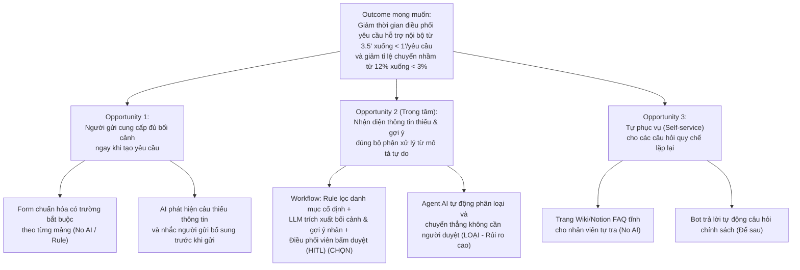
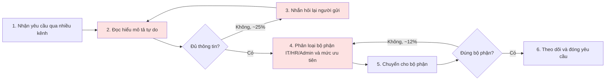
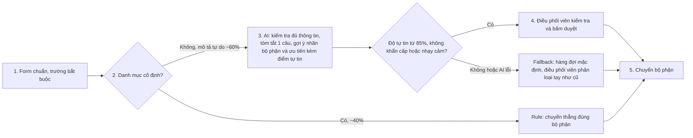

# Báo cáo nhóm — Day 02 Discovery & Problem Framing

> Bản chung của nhóm, viết trên repo do nhóm trưởng fork. Không copy file này sang repo cá nhân.
> Template chi tiết và prompt mẫu: [docs/01-worksheet.md](../../docs/01-worksheet.md). Bài mẫu: [docs/02-deliverable-example.md](../../docs/02-deliverable-example.md).

## 1. Thông tin nhóm — Điều phối chung: Phạm Việt Hưng (Nhóm trưởng)

> **Điều phối chung:** **Phạm Việt Hưng** (MSSV: `2A202603370` — Nhóm trưởng)  
> **Người đề xuất đề tài được chọn:** **Phạm Công Dũng** (MSSV: `2A202603428` — Candidate Problem #7 / Cluster A)

- Tên nhóm: **SUDO**
- Thành viên: xem [`TEAM.md`](../../TEAM.md) (*Phạm Việt Hưng, Chu Mai Hồng, Phạm Công Dũng, Nguyễn Huy Hoàng*)
- Candidate problem được chọn (1 câu): **Khi nhân viên gửi yêu cầu hỗ trợ nội bộ (IT, Hành chính, Nhân sự) qua nhiều kênh với mô tả tự do và thiếu thông tin bối cảnh, nhân sự điều phối (Helpdesk/Admin) phải đọc hiểu, hỏi lại thông tin và phân loại thủ công từng yêu cầu để chuyển đúng bộ phận, gây nghẽn thời gian phản hồi ban đầu và dễ chuyển nhầm đầu mối.**
- Người đề xuất đề tài được chọn: **Phạm Công Dũng** (Problem Card #1 cá nhân / Candidate #7)
- Quyết định cuối: **Go (phạm vi nhỏ — Pilot 2 tuần với kiến trúc Workflow: Form chuẩn hóa + Rule phân luồng cố định + AI kiểm tra thiếu thông tin & gợi ý nhãn phân loại + Điều phối viên duyệt chuyển)**

---

## 2. Hội tụ nhóm (CP3) — Phụ trách chính: Phạm Việt Hưng

> **Người phụ trách chính:** **Phạm Việt Hưng** (MSSV: `2A202603370`)  
> **Thành viên tham gia:** Chu Mai Hồng, Phạm Công Dũng, Nguyễn Huy Hoàng (cùng Pitch & phản biện chéo)

### 2.1. Pitch

Bảng tổng hợp 12 Problem Cards được các thành viên pitch và nhận phản biện chéo:

| # | Người đưa ra | Candidate (Job Story ngắn) | Actor | Bottleneck | Câu hỏi phản biện nhận được (ai hỏi) |
|---:|---|---|---|---|---|
| 1 | Phạm Việt Hưng | Khi chuẩn bị nộp bài lab hoặc báo cáo đồ án nhóm trên GitHub trước giờ deadline, tôi muốn đối chiếu toàn bộ bài làm của nhóm với các tiêu chí trong `RUBRIC.md` và `SUBMISSION.md`, để phát hiện kịp thời các mục còn thiếu hoặc sai quy định | Nhóm trưởng / người rà soát bài nộp của nhóm sinh viên | Bước mở song song nhiều file Markdown đọc đối chiếu từng mục báo cáo với Rubric & Rules (~20–25 phút/lần nộp) | *"Chỉ cần lập bảng Checklist tĩnh + script kiểm tra định dạng tên file và đếm từ (Rule) thì đã giải quyết được 80% rủi ro mất điểm chưa, có thực sự cần AI không?"* (Phạm Công Dũng & Chu Mai Hồng hỏi) |
| 2 | Phạm Việt Hưng | Khi vừa kết thúc buổi họp thảo luận nhóm (30–45 phút), tôi muốn có ngay danh sách đầu việc kèm người phụ trách và deadline, để gửi vào kênh chat nhóm cho mọi người làm đúng việc | Nhóm trưởng / thư ký cuộc họp nhóm (3–4 người) | Bước nhớ lại các thống nhất bằng miệng và gom thành bảng Task + Owner + Deadline (~12 phút/buổi) | *"Nếu mở sẵn bảng phân công trên màn hình share chung và điền trực tiếp trong 5 phút cuối buổi họp (No AI) thì có giải quyết được dứt điểm không?"* (Nguyễn Huy Hoàng hỏi) |
| 3 | Phạm Việt Hưng | Khi đang làm đồ án nhóm và cần kiểm tra lại một quy định hoặc quyết định đã chốt từ mấy ngày trước, tôi muốn tìm thấy ngay nội dung đó kèm ngữ cảnh, để không phải hỏi lại | Thành viên nhóm đồ án / nhóm học tập | Bước đọc lướt lại hàng chục tin nhắn trong kênh chat dài để xác định đâu là kết luận cuối cùng (~8–10 phút/lần) | *"Nhóm chỉ có 4 người, nếu quy ước ghim tin nhắn (Pin) hoặc ghi vào đầu file `TEAM.md` thì đã đủ chưa, có đáng dùng AI không?"* (Phạm Công Dũng hỏi) |
| 4 | Chu Mai Hồng | Khi nhân viên mới nhận việc (Onboarding) trong tuần đầu tiên, tôi muốn nắm rõ mình cần xin cấp những tài khoản, thiết bị và giấy tờ gì ở bộ phận nào, để hoàn tất thủ tục làm việc mà không phải hỏi lẻ tẻ nhiều người | Nhân viên mới & bộ phận HR / IT / Hành chính | Bước nhân viên mới phải tự hỏi từng phòng ban và chờ cấp quyền/thiết bị rời rạc (mất 2–3 ngày đầu) | *"Việc này chỉ cần 1 trang Checklist Onboarding cố định và 1 luồng tự động (Rule) khi có nhân sự mới là đủ, có chỗ nào thực sự mơ hồ cần tới AI không?"* (Phạm Việt Hưng hỏi) |
| 5 | Chu Mai Hồng | Khi cuối tuần cần tổng hợp báo cáo tình hình xử lý các yêu cầu vận hành nội bộ cho quản lý, tôi muốn có sẵn số lượng yêu cầu tồn đọng và nguyên nhân trễ hạn, để không phải lọc đếm thủ công từ bảng theo dõi | Nhân sự vận hành (Operations / Admin) | Bước lọc dữ liệu từ nhiều sheet và đọc ghi chú để phân nhóm nguyên nhân trễ (~45 phút/tuần) | *"Phần đếm số lượng hoàn toàn dùng Pivot Table / Dashboard (Rule) được; quản lý có thực sự đọc phần nhận định nguyên nhân mỗi tuần không?"* (Phạm Công Dũng hỏi) |
| 6 | Chu Mai Hồng | Khi nhận câu hỏi lặp lại của nhân viên về quy chế nghỉ phép, thanh toán chi phí hoặc lỗi máy in cơ bản, tôi muốn người hỏi xem được ngay hướng dẫn chuẩn, để không phải gõ trả lời lại cùng một nội dung mỗi ngày | Nhân sự HR / Admin / IT Helpdesk | Bước đọc tin nhắn hỏi lẻ và copy-paste hoặc gõ lại hướng dẫn cũ (5–7 lần/ngày, ~30 phút/ngày) | *"Vì sao nhân viên không tự đọc sổ tay quy chế nội bộ? Nếu họ lười tìm thì làm công cụ AI liệu họ có chịu gõ hỏi không?"* (Nguyễn Huy Hoàng hỏi) |
| 7 | **Phạm Công Dũng** *(Được chọn)* | **Khi nhân viên gửi yêu cầu hỗ trợ nội bộ (IT, Hành chính, Nhân sự) qua chat/email với mô tả tự do, tôi muốn nhanh chóng xác định đúng bộ phận xử lý và mức ưu tiên, để chuyển tiếp ngay mà không phải hỏi đi hỏi lại** | **Nhân sự điều phối (Helpdesk / Operations), 50–200 nhân sự** | **Bước đọc hiểu mô tả tự do thiếu thông tin, nhắn hỏi lại và phân loại thủ công (~3.5 phút/yêu cầu, ~30 yêu cầu/ngày)** | *"Nếu công ty ra quy định bắt buộc điền Form thì có cần AI nữa không? AI gợi ý sai thì ai chịu trách nhiệm?"* (Phạm Việt Hưng hỏi) |
| 8 | Phạm Công Dũng | Khi cần sắp xếp lịch phỏng vấn tuyển dụng giữa ứng viên và 2–3 người phỏng vấn nội bộ khác phòng ban, tôi muốn tìm được khung giờ trống chung và gửi thư mời tự động, để chốt lịch trong ngày mà không phải nhắn hỏi từng người | Recruiter / HR Tuyển dụng | Bước so sánh lịch Calendar của từng người và nhắn tin qua lại chờ xác nhận (~15–20 phút/lịch) | *"Google Calendar đã có tính năng 'Find a time' và các công cụ như Calendly giải quyết hoàn toàn bằng Rule, tại sao phải dùng AI?"* (Chu Mai Hồng hỏi) |
| 9 | Phạm Công Dũng | Khi kết thúc đợt đánh giá thử việc 2 tháng của nhân viên mới, tôi muốn tự động gom các nhận xét từ quản lý trực tiếp và đồng nghiệp, để lập báo cáo đánh giá mà không phải gửi email nhắc từng người | HR Vận hành / People Ops | Bước gửi email nhắc nhở và copy-paste nhận xét từ nhiều email/form vào một file tổng hợp (~30 phút/nhân sự) | *"Vấn đề này thiên về việc thiếu kỷ luật gửi nhận xét đúng hạn; nếu họ không nộp thì AI cũng không có dữ liệu để tổng hợp đúng không?"* (Nguyễn Huy Hoàng hỏi) |
| 10 | Nguyễn Huy Hoàng | Khi quản lý các yêu cầu hỗ trợ kỹ thuật và vận hành rải rác trên nhiều kênh (Slack, Zalo, Email), tôi muốn gom tập trung, kiểm tra thông tin thiếu và gợi ý phân loại đúng bộ phận xử lý, để tránh trôi tin nhắn khẩn cấp và giảm thời gian điều phối thủ công | Nhân sự điều phối (Helpdesk / Operations) & Trưởng bộ phận IT | Bước đọc hiểu mô tả tự do thiếu bối cảnh, hỏi lại thông tin và phân loại thủ công (~3.5 phút/yêu cầu, 30 yêu cầu/ngày) | *"Trùng khớp với đề xuất Card #7 của Công Dũng; nếu kết hợp thì đâu là ranh giới giữa bước chuẩn hóa đầu vào (Form/Rule) và bước AI gợi ý phân loại?"* (Phạm Việt Hưng hỏi) |
| 11 | Nguyễn Huy Hoàng | Khi làm đồ án nhóm nhiều thành viên, tôi muốn đồng bộ và kiểm tra trạng thái các biến môi trường (`.env`/secrets) giữa các máy, để không bị lỗi chạy code hoặc vô tình commit lộ key lên GitHub | Sinh viên làm đồ án phần mềm, Fresher Engineer | Bước nhắn gửi lại file `.env` thủ công mỗi khi thêm biến mới và dò lỗi lệch cấu hình (~15–30 phút/sprint) | *"Việc chặn commit key và kiểm tra biến thiếu giải quyết triệt để 100% bằng `.env.example` + Git pre-commit hook (Rule), hoàn toàn không cần AI đúng không?"* (Chu Mai Hồng hỏi) |
| 12 | Nguyễn Huy Hoàng | Khi ứng tuyển thực tập nhiều vị trí khác nhau, tôi muốn điều chỉnh mô tả dự án và kỹ năng trong CV cho khớp với trọng tâm của từng Job Description (JD), để không mất 30 phút sửa tay cho mỗi lần nộp đơn | Sinh viên năm cuối, ứng viên tìm việc Fresher | Bước đọc phân tích yêu cầu JD và viết lại các gạch đầu dòng kinh nghiệm trong CV (~25–30 phút/JD) | *"Rủi ro lớn nhất là nếu công cụ tự viết lại CV thì rất dễ phóng đại hoặc bịa kỹ năng ứng viên không có thật; đo lường hiệu quả thực tế trong 1 buổi lab bằng cách nào?"* (Phạm Công Dũng hỏi) |

---

### 2.2. Cluster

Sau khi cả 4 thành viên trình bày 12 Problem Cards và phản biện chéo, nhóm gom các candidate trùng hoặc cùng bản chất vào **4 Cluster**:

| Cluster | Các candidate | Pattern chung |
|---|---|---|
| **A — Tiếp nhận, kiểm tra thông tin & điều phối yêu cầu hỗ trợ nội bộ** | **#7** (Phạm Công Dũng — người đề xuất), **#10** (Nguyễn Huy Hoàng), **#4** (Chu Mai Hồng), **#6** (Chu Mai Hồng) | Nhân viên gửi yêu cầu/câu hỏi hỗ trợ (IT, HR, Hành chính) qua nhiều kênh với mô tả tự do thiếu thông tin chuẩn; người điều phối phải đọc hiểu, hỏi lại thông tin thiếu và phân loại thủ công về đúng bộ phận |
| **B — Tổng hợp tiến độ, biên bản họp & theo dõi đầu việc nhóm** | **#2** (Phạm Việt Hưng), **#5** (Chu Mai Hồng), **#9** (Phạm Công Dũng) | Gom thông tin rời rạc sau cuộc họp hoặc cuối tuần để viết tóm tắt và phân chia đầu việc cho các thành viên |
| **C — Rà soát tiêu chí, kiểm tra cấu hình & chuẩn hóa tài liệu** | **#1** (Phạm Việt Hưng), **#11** (Nguyển Huy Hoàng), **#12** (Nguyễn Huy Hoàng) | Đối chiếu một bản nháp/cấu hình (báo cáo lab, file `.env`, CV) với một bộ quy tắc hoặc yêu cầu mục tiêu (Rubric, `.env.example`, JD) để tìm điểm thiếu |
| **D — Tra cứu quyết định cũ & sắp xếp lịch/tài nguyên** | **#3** (Phạm Việt Hưng), **#8** (Phạm Công Dũng) | Tìm lại thông tin bị trôi trong kênh chat hoặc giải bài toán sắp xếp lịch theo ràng buộc |

---

### 2.3. Opportunity Solution Tree rút gọn

Cây OST rút gọn cấu trúc cơ hội xoay quanh bài toán được chọn (Cluster A):

---

### 2.4. Chấm điểm shortlist (1–5)

Nhóm rút gọn danh sách xuống **3 candidate tiêu biểu** đại diện cho 3 nhóm vấn đề khác nhau để chấm điểm:

1. **Candidate 1 (Cluster A — #7 Công Dũng & #10 Huy Hoàng):** Tiếp nhận và phân loại yêu cầu hỗ trợ nội bộ đa kênh (IT, Hành chính, Nhân sự).
2. **Candidate 2 (Cluster C — #1 Việt Hưng):** Rà soát báo cáo đồ án / bài lab theo Rubric và Quy định nộp bài GitHub.
3. **Candidate 3 (Cluster B — #2 Việt Hưng & #5 Mai Hồng):** Trích xuất danh sách công việc (Action items) và người phụ trách sau cuộc họp nhóm.

Bảng chấm điểm theo 7 tiêu chí (thang điểm 1–5):

| Tiêu chí | Trọng số | Candidate 1: Hỗ trợ nội bộ (Công Dũng) | Candidate 2: Rà soát Rubric (Việt Hưng) | Candidate 3: Action Items họp (Mai Hồng) |
|---|:---:|:---:|:---:|:---:|
| 1. Pain thật, đã thấy / trải qua | 15% | **4.5** (Nhiều người gặp, mất ~105' mỗi ngày) | **4.5** (Nhóm đang trải qua trực tiếp trước mỗi deadline) | **3.5** (Có gặp nhưng tần suất họp chỉ 1–2 lần/tuần) |
| 2. Có baseline đo được (thời gian / tần suất / lỗi) | 15% | **5.0** (3.5'/yêu cầu, 30 req/ngày, 25% thiếu tin, 12% nhầm) | **4.0** (Mất ~20–25' rà soát, rủi ro trừ điểm lỗi cú pháp) | **3.0** (Khó đo lường thời gian nhớ việc bị sót) |
| 3. Tần suất lặp lại (hàng ngày / hàng tuần) | 15% | **5.0** (Lặp lại hàng ngày liên tục trong giờ làm việc) | **3.0** (Chỉ lặp lại theo chu kỳ nộp bài/sprint 1–2 tuần/lần) | **3.0** (Chỉ diễn ra sau các buổi họp nhóm) |
| 4. Khả thi kiểm chứng trong buổi lab (CP4) | 15% | **4.5** (Có thể phỏng vấn ngay các bạn làm helpdesk/admin) | **4.5** (Kiểm chứng ngay trên chính bài làm của các nhóm khác) | **3.5** (Cần file ghi âm họp thật để test) |
| 5. Giải pháp không dùng AI chưa đủ tốt | 15% | **4.0** (Rule không hiểu mô tả tự do; Form cố định bị người dùng lười điền) | **2.5** (Rule tĩnh + checklist giải quyết được 80% lỗi format) | **3.0** (Điền trực tiếp bảng task cuối họp là giải quyết được) |
| 6. Boundary rõ (dễ kiểm soát rủi ro, fallback được) | 15% | **4.5** (HITL: AI chỉ gợi ý nhãn, điều phối viên bấm duyệt cuối) | **4.0** (Người nộp bài vẫn phải tự click submit) | **3.5** (Dễ bị ảo giác sót việc hoặc gán nhầm người) |
| 7. Rõ ràng, không bị cồng kềnh (vừa sức 1 buổi) | 10% | **4.5** (Tập trung đúng khâu đọc hiểu & phân loại yêu cầu) | **4.0** (Phải phân tích cấu trúc nhiều file markdown) | **3.5** (Cần tích hợp speech-to-text nếu dùng file âm thanh) |
| **Tổng điểm trọng số** | **100%** | **4.58 / 5.0** | **3.80 / 5.0** | **3.30 / 5.0** |

**Lý do chọn Candidate 1 (đề xuất của Phạm Công Dũng):**
- Đạt điểm cao nhất vượt trội (**4.58/5.0**).
- Điểm nghẽn rõ ràng, tần suất xảy ra mỗi ngày (~30 yêu cầu/ngày, mất hơn 100 phút/ngày của nhân sự điều phối).
- Chỉ số baseline và target vật lý cực kỳ rõ ràng, đo lường được ngay: thời gian điều phối từ `3.5 phút` xuống `< 1 phút/yêu cầu`, tỉ lệ chuyển nhầm từ `12%` xuống `< 3%`, tỉ lệ hỏi lại từ `25%` xuống `< 8%`.
- Có sự kết hợp chặt chẽ giữa Rule (xử lý danh mục cố định) và AI (xử lý mô tả tự do) dưới sự kiểm duyệt của con người (HITL), ranh giới kiểm soát an toàn và khả thi cao cho vòng Discovery.

**Lý do loại Candidate 2 và 3:**
- *Candidate 2 (Rà soát Rubric):* Phần lớn các lỗi định dạng tên file, thiếu mục heading, hay đếm từ hoàn toàn giải quyết bằng checklist và script Regex/Rule đơn giản, nếu dùng AI thì thừa thãi (Overkill) và tần suất chỉ diễn ra 1–2 tuần một lần vào kỳ nộp bài.
- *Candidate 3 (Action Items cuộc họp):* Tần suất thấp, việc ghi nhận công việc hoàn toàn giải quyết dứt điểm bằng No AI (mở bảng share màn hình cùng gõ 5 phút cuối buổi họp); nếu dùng AI trích xuất từ audio thì vượt quá phạm vi và thời gian của buổi lab (rủi ro ASR và ảo giác gán sai task).

---

## 3. Kiểm chứng + research giải pháp đã có (CP4) — Phụ trách chính: Phạm Công Dũng & Nguyễn Huy Hoàng

> **Người phụ trách chính:** **Phạm Công Dũng** (Mục 3.1 & 3.2) & **Nguyễn Huy Hoàng** (Mục 3.3)  
> **Người hỗ trợ:** Chu Mai Hồng (Hỗ trợ phỏng vấn), Phạm Việt Hưng (Hỗ trợ review research)

### 3.1. Assumption Map — Phụ trách chính: Phạm Công Dũng

> **Người phụ trách chính:** **Phạm Công Dũng** (MSSV: `2A202603428`)

Bảng 5 giả định rủi ro cốt lõi của bài toán theo phương pháp David Bland (*Testing Business Ideas*):

| # | Giả định | Loại (Value / Usability / Feasibility / Viability) | Quan trọng (1–5) | Đã có bằng chứng (1–5) | Kiểm chứng trước? |
|---:|---|---|---:|---:|---|
| 1 | Nhân sự điều phối thực sự mất quá nhiều thời gian cho việc đọc hiểu mô tả tự do và nhắn tin hỏi lại thông tin cơ bản (~2.5 phút/yêu cầu) | **Value** | 5 | 4 | ✅ (Kiểm chứng ngay) |
| 2 | Tỉ lệ chuyển nhầm bộ phận (12%) gây bức xúc thực sự cho các bên, làm ticket bị đá qua lại và trễ hạn xử lý cam kết (SLA) | **Value** | 5 | 4 | ✅ (Kiểm chứng ngay) |
| 3 | Nhân viên gửi yêu cầu có xu hướng lười chọn dropdown chi tiết và ngại đọc tài liệu hướng dẫn, thích gõ mô tả tự do theo thói quen | **Usability** | 4 | 3 | ✅ (Kiểm chứng ngay) |
| 4 | Hơn 40% số yêu cầu hỗ trợ là các tác vụ hành chính/thủ tục lặp lại đơn giản (cấp lại pass, văn phòng phẩm, xin nghỉ) không cần tới AI mà giải quyết được bằng Rule | **Feasibility** | 5 | 4 | ✅ (Kiểm chứng ngay) |
| 5 | Nhân sự điều phối không tin tưởng AI tự động chuyển thẳng (Autonomous Agent) vì sợ trách nhiệm giải trình khi AI chuyển sai sự cố khẩn cấp | **Viability** | 5 | 5 | ✅ (Kiểm chứng ngay) |

*Nhóm ưu tiên kiểm chứng trực tiếp Giả định #1, #2, #4 và #5 trong buổi lab vì đây là các giả định có tính sống còn đối với kiến trúc giải pháp.*

---

### 3.2. Kiểm chứng thực tế (The Mom Test — Đạt chuẩn Bonus B2: 5 Interview Snapshots) — Phụ trách chính: Phạm Công Dũng

> **Người phụ trách chính:** **Phạm Công Dũng** (MSSV: `2A202603428`)  
> **Người hỗ trợ:** Chu Mai Hồng (MSSV: `2A202603377`), Phạm Việt Hưng (MSSV: `2A202603370`)

**Cách đã dùng:**
- Thực hiện phỏng vấn sâu **5 nhân sự thực tế** (gồm cả bên tiếp nhận điều phối, bên chuyên môn xử lý và bên gửi yêu cầu) theo đúng 3 nguyên tắc của **The Mom Test** (Rob Fitzpatrick): hỏi về hành vi quá khứ, sự việc cụ thể lần gần nhất đã xảy ra và chi phí thời gian/công sức thật; tuyệt đối không hỏi câu hỏi giả định tương lai hay xin lời khen về ý tưởng AI.
- Thực hiện khảo sát nhanh (poll) **6 bạn học/đồng nghiệp** từng tiếp nhận hoặc gửi ticket hỗ trợ nội bộ.

#### Interview Snapshot #1 — Chuyên viên IT Helpdesk (Bên tiếp nhận & xử lý kỹ thuật)

| Trường | Nội dung |
|---|---|
| Người được hỏi (vai trò, không ghi tên thật) | Chuyên viên IT Support / Helpdesk tại công ty công nghệ quy mô ~150 nhân sự. |
| Câu nói đáng nhớ nhất (nguyên văn) | *"Cứ sáng thứ Hai là 10 tin nhắn kiểu 'Anh ơi mạng lag quá' hay 'Phần mềm lỗi rồi', không có nổi một cái ảnh chụp màn hình hay tên phòng, em toàn phải hỏi lại từng người xem đang ngồi tầng mấy, dùng mạng gì mới dám chạy lên."* |
| Lần gần nhất gặp vấn đề này | Sáng thứ Hai đầu tuần, 4 nhân viên cùng báo không truy cập được thư mục dùng chung nhưng chỉ nhắn 1 câu cụt lủn qua Zalo; mất 20 phút hỏi từng người mới phát hiện chỉ những ai vừa đổi mật khẩu Windows mới bị văng quyền. |
| Hiện đang xử lý bằng cách nào (workaround)? | Ghim sẵn 1 đoạn văn bản mẫu (cần chụp màn hình + mã tài sản máy + vị trí ngồi) trên Notepad để copy-paste hỏi lại mỗi khi nhận tin nhắn thiếu thông tin. |
| Mất bao lâu, bao lần? | Xử lý 15–20 ca IT/ngày; khoảng 1/3 số ca phải nhắn hỏi lại thông tin cơ bản, mất 3–5 phút chờ phản hồi cho mỗi ca trước khi bắt tay vào sửa. |
| Insight / opportunity rút ra | Điểm nghẽn lớn nhất trước khi xử lý kỹ thuật là **thiếu thông tin bối cảnh tối thiểu** (mã lỗi, ảnh màn hình, thiết bị); nếu kiểm tra và nhắc bổ sung ngay lúc gửi sẽ giảm mạnh thời gian hỏi đi hỏi lại. |

#### Interview Snapshot #2 — Nhân sự Điều phối Vận hành / Admin Helpdesk (Actor trung tâm)

| Trường | Nội dung |
|---|---|
| Người được hỏi (vai trò, không ghi tên thật) | Nhân viên Helpdesk / Vận hành nội bộ (phụ trách điều phối chung ticket IT, Hành chính & Nhân sự tại công ty ~120 người). |
| Câu nói đáng nhớ nhất (nguyên văn) | *"Em sợ nhất không phải là việc trả lời tin nhắn, mà là chuyển nhầm một sự cố mạng khẩn cấp của sếp sang bên Hành chính rồi bị đá qua đá lại, đến lúc sếp giục mới vỡ lẽ thì em là đứa chịu đòn giải trình đầu tiên!"* |
| Lần gần nhất gặp vấn đề này | Sáng thứ Năm tuần trước, một nhân viên nhắn: 'Máy tính không vào được hệ thống, cần gấp!', không ghi mã máy hay phần mềm nào. Điều phối viên phải nhắn lại 2 lần mới biết là quên mật khẩu VPN nội bộ, mất gần 15 phút luồng giao tiếp qua lại. |
| Hiện đang xử lý bằng cách nào (workaround)? | Mở cùng lúc 3 cửa sổ chat (Slack, Zalo, Email) và gõ tay vào 1 file Google Sheets để theo dõi, tự nhớ danh sách ai phụ trách mảng nào để tag tên. |
| Mất bao lâu, bao lần? | Mất trung bình 3.5 phút/yêu cầu; tiếp nhận ~30 yêu cầu mỗi ngày (~105 phút/ngày), chiếm trọn hơn 1.5 tiếng đầu mỗi buổi sáng. |
| Insight / opportunity rút ra | Nỗi sợ lớn nhất của người điều phối là **'chuyển nhầm' và 'trách nhiệm giải trình'**. Do đó, hệ thống tuyệt đối không được tự động chuyển thẳng (Autonomous Agent) mà luôn cần con người kiểm tra nhanh và bấm duyệt (Human-in-the-loop). |

#### Interview Snapshot #3 — Chuyên viên Hành chính - Nhân sự (Bên nhận yêu cầu Admin & HR)

| Trường | Nội dung |
|---|---|
| Người được hỏi (vai trò, không ghi tên thật) | Chuyên viên Hành chính - Nhân sự (HR & Admin Generalist) tại doanh nghiệp dịch vụ ~90 người. |
| Câu nói đáng nhớ nhất (nguyên văn) | *"Mấy việc xin văn phòng phẩm, đặt phòng họp hay xin nghỉ phép thì form có sẵn rồi, các bạn tích 30 giây là xong; chỉ đau đầu mấy ca lưng chừng kiểu 'Em mới chuyển chỗ ngồi không cắm được màn hình phụ với thiếu ổ điện' — đẩy sang IT thì IT bảo ổ điện của Hành chính, đẩy về Hành chính thì bảo cáp màn hình của IT."* |
| Lần gần nhất gặp vấn đề này | Tuần trước có 3 yêu cầu chuẩn bị chỗ ngồi cho nhân sự điều chuyển nội bộ bị chuyển lòng vòng giữa Admin và IT suốt cả buổi sáng vì mô tả gộp cả thiết bị mạng lẫn bàn ghế. |
| Hiện đang xử lý bằng cách nào (workaround)? | Tạo 1 group chat chung có cả IT và Admin, ca nào lưng chừng thì forward tin nhắn vào đó để hai bên tự nhận. |
| Mất bao lâu, bao lần? | Các ca cố định mất < 30 giây nhờ Google Form; nhưng các ca mô tả tự do giáp ranh (chiếm ~15% tổng yêu cầu) mất 10–15 phút trao đổi qua lại mới chốt được đầu mối. |
| Insight / opportunity rút ra | **Tín hiệu phản bác cực kỳ quan trọng:** Các yêu cầu thủ tục cố định (~40% số ca như văn phòng phẩm, đặt phòng, nghỉ phép) đã chạy tốt bằng Form + Rule, hoàn toàn không cần AI. AI chỉ có giá trị ở các ca mô tả sự cố tự do hoặc giáp ranh nhiều bộ phận. Also, các yêu cầu HR nhạy cảm (lương thưởng, kỷ luật) không được phép đưa qua công cụ bên thứ ba. |

#### Interview Snapshot #4 — Trưởng nhóm Kỹ thuật (Người duyệt & chịu ảnh hưởng bởi SLA)

| Trường | Nội dung |
|---|---|
| Người được hỏi (vai trò, không ghi tên thật) | Team Lead Kỹ thuật / Hạ tầng nội bộ tại công ty phần mềm ~180 nhân sự. |
| Câu nói đáng nhớ nhất (nguyên văn) | *"Có hôm cả phòng họp khách hàng bị mất kết nối máy chiếu mà ticket lại nằm ở mức 'Bình thường' dưới đáy hàng đợi cùng với mấy ca xin cài thêm font chữ, đến lúc giám đốc gọi điện thẳng cho anh thì đã trễ mất 20 phút họp của khách."* |
| Lần gần nhất gặp vấn đề này | Thứ Ba tuần trước, sự cố lỗi xác thực tài khoản demo cho khách hàng bị gán nhầm mức ưu tiên thấp do người gửi chỉ viết ngắn gọn 'Tài khoản test không đăng nhập được', không ai nhận ra đó là ca đang họp trực tiếp với khách. |
| Hiện đang xử lý bằng cách nào (workaround)? | Dặn nhân sự điều phối nếu thấy tin nhắn nào có chữ 'khách hàng', 'phòng họp VIP', 'sập server' thì phải gọi điện hoặc tag khẩn cấp ngay. |
| Mất bao lâu, bao lần? | Mỗi tháng xảy ra 2–3 vụ sự cố khẩn cấp (`P1`) bị phân loại nhầm thành bình thường (`P3`), mỗi lần làm trễ SLA từ 15–30 phút. |
| Insight / opportunity rút ra | Bỏ sót mức độ khẩn cấp (**False Negative — gán nhãn Thường cho sự cố Khẩn cấp**) gây hậu quả nặng nề hơn rất nhiều so với báo nhầm (**False Positive**). Cần thiết kế AI gắn cờ cảnh báo ưu tiên và có **Ngưỡng dừng an toàn tức thời (Kill-Switch)** nếu lọt sự cố `P1`. |

#### Interview Snapshot #5 — Nhân viên Kinh doanh / Vận hành (Người gửi yêu cầu hỗ trợ)

| Trường | Nội dung |
|---|---|
| Người được hỏi (vai trò, không ghi tên thật) | Chuyên viên Kinh doanh (Account Executive) — người thường xuyên gửi yêu cầu hỗ trợ IT & Hành chính. |
| Câu nói đáng nhớ nhất (nguyên văn) | *"Lúc máy đang treo hoặc cần in gấp hợp đồng cho khách mà bắt em mở portal chọn qua 5 tầng danh mục kỹ thuật kiểu 'Hạ tầng mạng / Giao thức VPN / Lỗi DNS' là em chịu chết, em chỉ biết nhắn thẳng vào khung chat là không mở được file thôi!"* |
| Lần gần nhất gặp vấn đề này | Chiều thứ Sáu tuần trước, cần in gấp phụ lục hợp đồng nhưng máy in báo đèn đỏ; mở form nội bộ thấy hơn 20 mã danh mục kỹ thuật không hiểu gì nên quay ra nhắn tin riêng cho bạn Admin, sau đó bạn Admin lại phải hỏi lại mã máy in rồi chuyển tiếp cho IT. |
| Hiện đang xử lý bằng cách nào (workaround)? | Nhắn tin tự do theo ngôn ngữ đời thường vào kênh hỗ trợ chung hoặc nhắn trực tiếp cho người quen ở phòng Admin/IT. |
| Mất bao lâu, bao lần? | Gửi 2–3 yêu cầu/tuần; trung bình phải chờ 15–20 phút mới được chuyển đúng người xử lý nếu mô tả ban đầu bị thiếu thông tin. |
| Insight / opportunity rút ra | Người gửi **không có kiến thức chuyên môn để tự chọn cây danh mục kỹ thuật sâu**, họ luôn có nhu cầu mô tả tự do bằng ngôn ngữ tự nhiên khi gặp sự cố bất thường. Giải pháp cần giữ Form thật gọn cho các việc quen thuộc và để AI đọc hiểu mô tả tự do giúp họ. |

#### Tổng hợp tín hiệu xác nhận & phản bác

| Nguồn | Số mẫu | Tín hiệu xác nhận | Tín hiệu phản bác |
|---|---:|---|---|
| **Phỏng vấn sâu (The Mom Test)** | **5** | - 5/5 xác nhận điểm nghẽn nằm ở mô tả tự do thiếu bối cảnh (~25% phải hỏi lại) và phân loại sai đối với sự cố bất thường/giáp ranh (~12% chuyển nhầm). - Xác nhận nỗi sợ lớn nhất của điều phối viên là trách nhiệm giải trình khi chuyển nhầm hoặc bỏ sót sự cố khẩn cấp `P1`. | - **Phản bác tự động hóa toàn bộ:** ~40% yêu cầu cố định (văn phòng phẩm, đặt phòng, nghỉ phép) chỉ cần Form + Rule là xong trong 30 giây, không cần AI. - **Phản bác mức Agent:** Điều phối viên và HR từ chối để AI tự động chuyển thẳng hoặc đụng vào dữ liệu nhân sự nhạy cảm. |
| **Khảo sát nhanh (Poll)** | **6** | - 5/6 từng gặp cảnh gửi yêu cầu xong bị hỏi lại nhiều lần hoặc chuyển lòng vòng giữa IT và Admin. | - 2/6 cho rằng với các thủ tục hành chính thông thường thì quy định điền Form bắt buộc là đủ. |

#### Nhóm đã sửa Problem, Metric và Quyết định thế nào sau kiểm chứng

1. **Sửa Problem & Kiến trúc giải pháp (Từ "AI toàn phần" sang "Hybrid Rule + Workflow AI + HITL"):**
   - Từ bỏ hoàn toàn ý định ban đầu là xây dựng một "Agent AI tự động tiếp nhận và giải quyết mọi ticket".
   - Tách quy trình thành 2 nhánh rõ rệt dựa trên Snapshot #3 và #5: nhánh **Rule (No AI)** tự động định tuyến thẳng ~40% yêu cầu thuộc danh mục cố định; nhánh **AI trong Workflow** chỉ xử lý ~60% yêu cầu mô tả sự cố tự do để kiểm tra thiếu thông tin, tóm tắt 1 câu và gợi ý nhãn cho điều phối viên bấm duyệt (**HITL** — giải quyết triệt để nỗi sợ ở Snapshot #2).
2. **Sửa Success Metric (Bổ sung Metric đo chất lượng gợi ý của AI):**
   - Từ phản hồi của điều phối viên (Snapshot #2), nhóm nhận ra nếu AI gợi ý sai quá nhiều thì điều phối viên phải sửa lại nhãn còn tốn thời gian hơn cũ; do đó nhóm bổ sung chỉ số thứ 4 vào Problem Statement v1 (Mục 7): **Tỉ lệ điều phối viên đồng ý với nhãn AI gợi ý đạt `≥ 80%`**.
3. **Sửa Boundary & Quyết định Pilot (Tách dữ liệu HR và thêm Kill-Switch cho sự cố P1):**
   - Từ Snapshot #3 (lo ngại bảo mật dữ liệu HR) và Snapshot #4 (hậu quả trễ SLA của sự cố khẩn cấp `P1`), nhóm quyết định ở Mục 8: **chỉ chạy Pilot 2 tuần cho mảng `IT Support` và `Hành chính`** (tách mảng `HR` đi bằng Rule nội bộ), đồng thời thiết lập **Ngưỡng dừng an toàn tức thời (Safety Kill-Switch)** nếu bất kỳ sự cố `P1` nào bị AI phân loại nhầm thành `P3`.

---

### 3.3. Research giải pháp đã có — Phụ trách chính: Nguyễn Huy Hoàng

> **Người phụ trách chính:** **Nguyễn Huy Hoàng** (MSSV: `2A202603366`)  
> **Người hỗ trợ:** Phạm Việt Hưng (MSSV: `2A202603370`)

| Công cụ / case / pattern | Link | Giải bước nào trong quy trình? | Điểm mạnh | Khoảng trống / rủi ro | Bài học cho nhóm |
|---|---|---|---|---|---|
| **Atlassian Rovo / Jira Service Management** | [Jira Service Management](https://www.atlassian.com/software/jira/service-management) | Giải quyết bước phân loại ticket và đề xuất tài liệu hướng dẫn cho agent. | Tích hợp sâu hệ sinh thái enterprise, AI tự động gắn nhãn và phân nhóm ticket rất mạnh. | Quá cồng kềnh, phức tạp và đắt đỏ đối với các tổ chức quy mô nhỏ (50–200 người). | Không tự xây dựng hệ thống quản lý cồng kềnh từ đầu mà học hỏi mô hình phân loại tự động. |
| **Zendesk Intelligent Triage** | [Zendesk AI](https://www.zendesk.com/service/ticketing/intelligent-triage/) | Giải quyết bước phân tích ý định (intent) và định tuyến ưu tiên từ yêu cầu thô. | Phân tích cảm xúc và ý định người gửi chuẩn xác, tự động hóa routing luồng nhanh. | Khó tùy chỉnh sâu các quy tắc nghiệp vụ đặc thù nội bộ bên ngoài chăm sóc khách hàng. | Cần thiết kế mô hình AI tập trung vào việc đọc hiểu mô tả tự do và gợi ý nhãn phân loại. |
| **Freshservice (Freddy AI)** | [Freshservice](https://www.freshworks.com/freshservice/) | Giải quyết bước tự động đề xuất danh mục sự cố và gán cho nhóm chuyên môn. | Giao diện trực quan, Freddy AI đề xuất danh mục sự cố dựa trên lịch sử dữ liệu cũ tốt. | Chi phí bản quyền cao, phụ thuộc hoàn toàn vào cơ sở dữ liệu lịch sử sẵn có của nền tảng. | Tận dụng cơ chế rule kết hợp AI để gợi ý danh mục cố định giúp tăng tốc độ xử lý. |
| **n8n Workflow Automation (Low-code)** | [n8n.io](https://n8n.io/) | Giải quyết toàn bộ luồng tích hợp Webhook, gọi LLM API trích xuất JSON và điều phối. | Linh hoạt tuyệt đối, dễ kết nối API tự do (Slack/Form với LLM), chi phí tự host tối ưu. | Đòi hỏi kỹ thuật cấu hình và bảo trì hạ tầng workflow riêng của đội ngũ. | Chọn kiến trúc Workflow (Form + Rule + LLM + HITL) triển khai qua Low-code/API là khả thi nhất cho lab. |

**Kết luận research:**
Thị trường đã có sẵn các mô hình phân loại ticket rất mạnh, vì vậy nhóm khẳng định **không tự viết lại hệ thống ticketing hay xây agent độc lập từ đầu**. Hướng đi khả thi nhất là kết hợp **Form chuẩn hóa + Rule định tuyến danh mục cố định + 1 mô-đun LLM Workflow đọc hiểu mô tả tự do + Điều phối viên kiểm duyệt (HITL)**.

---

## 4. Quy trình trước/sau (CP5) — Phụ trách chính: Chu Mai Hồng

> **Người phụ trách chính:** **Chu Mai Hồng** (MSSV: `2A202603377`)  
> **Người hỗ trợ:** Phạm Việt Hưng (MSSV: `2A202603370`)

### 4.1. Quy trình hiện tại

Sơ đồ (Mermaid):

Bảng phân tích chi tiết từng bước trong quy trình hiện tại:

| Bước | Actor | Input | Output | Thời gian / tần suất | Ghi chú |
|---:|---|---|---|---|---|
| 1 | Nhân viên gửi, điều phối viên nhận | Yêu cầu qua email, chat hoặc trực tiếp | Yêu cầu đã ghi nhận | ~0.3 phút/yêu cầu | ~30 yêu cầu/ngày |
| 2 | Điều phối viên | Mô tả tự do | Hiểu nội dung, nhận ra còn thiếu gì | ~1.0 phút | **Bottleneck 1** |
| 3 | Điều phối viên, người gửi | Yêu cầu thiếu thông tin | Thông tin bổ sung | ~0.8 phút (trung bình trên mọi yêu cầu) | **Bottleneck 2**; ~25% yêu cầu phải hỏi lại |
| 4 | Điều phối viên | Yêu cầu đã đủ thông tin | Nhãn bộ phận (IT/HR/Admin) và mức ưu tiên | ~0.7 phút | **Bottleneck 3**; ~12% bị chuyển nhầm |
| 5 | Điều phối viên | Yêu cầu đã phân loại | Yêu cầu nằm ở đúng hàng đợi bộ phận | ~0.3 phút | Chuyển thủ công sang nhóm chuyên môn |
| 6 | Điều phối viên, bộ phận xử lý | Yêu cầu đang xử lý | Yêu cầu được đóng | ~0.4 phút | Cập nhật trạng thái và báo lại người gửi |

- **Tổng thời gian:** **3.5 phút/yêu cầu**, khoảng **105 phút/ngày** (với 30 yêu cầu/ngày). Bước 2–4 chiếm tới **2.5 phút**.
- **Bottleneck chính:** Bước 2, 3 và 4. Điều phối viên phải đọc hiểu mô tả tự do thiếu thông tin, nhắn hỏi lại người gửi, rồi phân loại bộ phận và mức ưu tiên bằng tay.
- **Hậu quả:** Khoảng **25% yêu cầu thiếu thông tin** phải hỏi lại và khoảng **12% bị chuyển nhầm bộ phận**, gây nghẽn tiếp nhận ban đầu và trễ SLA.

---

### 4.2. Quy trình tương lai

Mức can thiệp: **Workflow (Augment — hỗ trợ con người)**, mục tiêu **dưới 1 phút/yêu cầu**.

Các thành phần kiểm soát trong quy trình mới:
- **Rule:** Form tiếp nhận chuẩn hóa có các trường bắt buộc; các danh mục cố định (cấp lại mật khẩu, xin nghỉ phép, đặt phòng họp) được chuyển thẳng, không cần AI.
- **AI (LLM trong Workflow):** Với mô tả tự do, AI kiểm tra đã đủ thông tin chưa, tóm tắt 1 câu, gợi ý nhãn bộ phận (IT/HR/Hành chính) và mức ưu tiên (Khẩn cấp/Thường) kèm điểm tự tin.
- **Con người (HITL):** Điều phối viên kiểm tra và bấm duyệt chuyển tiếp 100% các yêu cầu mô tả tự do.
- **Boundary:** AI không tự đóng yêu cầu; không tự chuyển thẳng yêu cầu khẩn cấp, nhạy cảm (HR, Tài chính) hoặc có độ tự tin dưới 85% khi chưa có điều phối viên duyệt.
- **Phương án quay về (Fallback):** Nếu AI lỗi hoặc độ tự tin thấp, yêu cầu tự động đẩy vào hàng đợi mặc định để điều phối viên phân loại thủ công như quy trình cũ.

---

### 4.3. Before / after

| Chỉ số | Trước | Sau (kỳ vọng) | Ghi chú |
|---|---|---|---|
| **Số bước** | 6 bước rời rạc | 5 bước đồng bộ | Gộp đọc hiểu, hỏi lại và phân loại vào form chuẩn, rule và gợi ý của AI |
| **Tổng thời gian** | 3.5 phút/yêu cầu (~105 phút/ngày) | **Dưới 1 phút/yêu cầu** (~30 phút/ngày) | Với 30 yêu cầu/ngày, tiết kiệm khoảng **75 phút/ngày** cho nhân sự điều phối |
| **Số bước thủ công** | 5 bước do điều phối viên làm tay (bước 2 đến 6) | 1 bước chính (kiểm tra & bấm duyệt) với mô tả tự do; 0 bước với danh mục cố định | Giảm tải thao tác tay đáng kể |
| **Bottleneck chính** | Bước 2, 3, 4 (Đọc hiểu, nhắn hỏi lại, phân loại) | Bước 4 (Duyệt nhanh của điều phối viên) | Nút thắt chuyển từ xử lý thủ công sang kiểm tra xác nhận |
| **Rủi ro mới phát sinh** | Không có | AI gợi ý sai và điều phối viên tin quá mức; dữ liệu nhạy cảm gửi cho LLM; người dùng bỏ qua form | Kiểm soát bằng HITL, Boundary, Fallback và 3 Ngưỡng dừng |

---

## 5. Problem Statement v0 (CP5) — Phụ trách chính: Phạm Công Dũng

> **Người phụ trách chính:** **Phạm Công Dũng** (MSSV: `2A202603428`)  
> **Người hỗ trợ:** Phạm Việt Hưng (MSSV: `2A202603370` — Hỗ trợ phản biện lỗ hổng)

Bảng Problem Statement v0 đủ 6 trường cốt lõi theo khung Lean UX & Google PAIR:

| Trường | Nội dung bản v0 |
|---|---|
| **Actor** | Nhân sự điều phối hỗ trợ nội bộ (Helpdesk / Operations / Admin) tại các tổ chức vừa và nhỏ (50–200 người). |
| **Quy trình** | Tiếp nhận yêu cầu hỗ trợ (IT, Hành chính, Nhân sự) gửi qua tin nhắn chat/email, đọc mô tả tự do, hỏi lại thông tin thiếu và phân loại thủ công chuyển cho bộ phận chuyên trách. |
| **Bottleneck** | Phải đọc hiểu văn bản tự do thiếu ngữ cảnh, nhắn tin hỏi lại thông tin cơ bản và tự đoán phòng ban xử lý thủ công (mất ~3.5 phút/yêu cầu, 25% thiếu thông tin, 12% chuyển nhầm). |
| **Impact** | Nghẽn tốc độ phản hồi ban đầu, lãng phí ~105 phút/ngày của điều phối viên, trễ cam kết hỗ trợ (SLA) và làm gián đoạn công việc của nhân viên toàn công ty. |
| **Success Metric** | - Thời gian xử lý: từ 3.5 phút xuống < 1 phút/yêu cầu. - Tỉ lệ phải hỏi lại thông tin: từ 25% xuống < 8%. - Tỉ lệ chuyển nhầm bộ phận: từ 12% xuống < 3%. |
| **Boundary** | AI không tự động trả lời thay chuyên viên kỹ thuật và không được tự ý đóng yêu cầu hỗ trợ. |

**Phản biện nhận được cho bản v0:**
- *Về Boundary:* Bản v0 mới chỉ ghi những điều cấm cơ bản (không đóng ticket, không trả lời thay), nhưng chưa quy định rõ ranh giới về **độ tự tin** và **yêu cầu nhạy cảm/khẩn cấp** (AI có được tự động định tuyến không? Khi nào bắt buộc phải có con người kiểm duyệt?).
- *Về Success Metric:* 3 chỉ số trong v0 chỉ đo tốc độ và tỷ lệ lỗi chung của cả quy trình, **chưa có chỉ số đo lường trực tiếp chất lượng đầu ra của AI** (điều phối viên có thực sự tin tưởng và đồng ý với nhãn AI gợi ý hay không?).
- *Về Mức can thiệp:* Chưa làm rõ ranh giới giữa việc dùng Rule cho form chuẩn và AI cho mô tả tự do, dễ bị hiểu nhầm sang hướng xây dựng Agent tự động hoàn toàn.
- *Chuyển giao:* Toàn bộ các lỗ hổng này được bạn Nguyễn Huy Hoàng tiếp thu và nâng cấp triệt để lên bản **Problem Statement v1 tại Mục 7**.

---

## 6. Mức can thiệp AI (CP6) — Phụ trách chính: Chu Mai Hồng

> **Người phụ trách chính:** **Chu Mai Hồng** (MSSV: `2A202603377`)  
> **Người hỗ trợ:** Phạm Công Dũng (MSSV: `2A202603428`)

### 6.1. Ma trận độ mơ hồ × độ phức tạp

Bài toán của nhóm được định vị tại ô: **Độ mơ hồ cao ở đầu vào (Mô tả tự do không cấu trúc) × Độ phức tạp vừa phải (Đầu ra là số ít nhãn phân loại cố định kèm mức ưu tiên)**.

- **Vì sao không phải ô phức tạp cao:** Bài toán không yêu cầu AI phải tự lập kế hoạch hành động nhiều bước hay tự thực thi sửa lỗi kỹ thuật, mà chỉ cần trích xuất thông tin, tóm tắt và gán nhãn vào danh mục xác định sẵn.
- **Vì sao đầu vào mơ hồ:** Ngôn ngữ tự nhiên của nhân viên khi báo sự cố rất đa dạng (viết tắt, tiếng lóng, thiếu bối cảnh thiết bị), đây là vùng mà các câu lệnh Rule tĩnh/Regex hoàn toàn bất lực và cần đến năng lực hiểu ngôn ngữ tự nhiên của LLM.

---

### 6.2. So sánh 4 mức

| Mức | Phương án cho bài của nhóm | Đủ khi nào | Rủi ro | Chọn? |
|---|---|---|---|---|
| **No AI (Sửa quy trình)** | Gom về một kênh, thiết kế form chuẩn, ban hành hướng dẫn cách mô tả | Hầu hết yêu cầu có cấu trúc rõ ràng | Không xử lý được mô tả tự do và các sự cố giáp ranh nhiều bộ phận | **Một phần** (Là nền tảng của Workflow) |
| **Rule** | Form có trường bắt buộc, tự động chuyển thẳng các danh mục cố định | Yêu cầu lặp lại cố định (xin nghỉ, cấp mật khẩu) | Cứng nhắc; phân loại sai khi người dùng chọn bừa danh mục | **Một phần** (Lớp đầu của Workflow) |
| **Workflow (Augment)** | Rule cho phần cố định; AI kiểm tra thiếu tin và gợi ý nhãn cho mô tả tự do; Điều phối viên duyệt cuối | Có phần mơ hồ nhưng quy trình ổn định và bắt buộc cần con người kiểm soát | AI gợi ý sai, điều phối viên tin quá mức | **CHỌN** |
| **Agent** | AI tự phân loại, tự chuyển, tự hỏi lại người gửi và tự đóng yêu cầu | Tác vụ nhiều bước, ít rủi ro, bối cảnh dữ liệu hoàn chỉnh | Sai sót nghiêm trọng ở yêu cầu khẩn cấp; mất dấu vết kiểm soát; chi phí vượt nhu cầu quy mô 50–200 người | **Không** |

**Mức chọn:** **Workflow (Augment — Hỗ trợ con người)**.

**Vì sao không chọn mức đơn giản hơn:** Kiểm chứng ở CP4 cho thấy yêu cầu lặp cố định chỉ cần Form + Rule, nhưng nỗi đau lớn nhất nằm ở yêu cầu mô tả sự cố tự do hoặc giáp ranh nhiều bộ phận mà Rule không đọc hiểu được. Do đó, nhóm kết hợp Rule cho phần cố định và chỉ dùng AI đúng điểm nghẽn mô tả tự do.
**Vì sao không chọn Agent:** Tránh rủi ro AI tự ý chuyển nhầm sự cố khẩn cấp gây vi phạm cam kết hỗ trợ (SLA) và đảm bảo an toàn tuyệt đối cho dữ liệu doanh nghiệp.

---

### 6.3. AI Canvas rút gọn

| Thành phần | Nội dung |
|---|---|
| **Prediction** (AI dự đoán / tạo ra gì?) | Dự đoán yêu cầu đã đủ thông tin chưa; tóm tắt 1 câu; gợi ý nhãn bộ phận (IT/HR/Hành chính); mức ưu tiên (Khẩn cấp/Thường); điểm độ tự tin (Confidence score). |
| **Judgment** (Con người cân nhắc, quyết định gì?) | Điều phối viên quyết định nhãn gợi ý có chính xác không, yêu cầu có tính chất khẩn cấp hoặc chứa dữ liệu nhạy cảm không, có cần nhắn hỏi lại người gửi không. |
| **Action** (Hành động cuối cùng là gì, ai làm?) | Điều phối viên bấm nút xác nhận duyệt và chuyển đúng bộ phận chuyên môn, hoặc sửa nhãn, hoặc đẩy về hàng đợi xử lý thủ công. |
| **Outcome** (Đo kết quả bằng gì?) | - Thời gian điều phối: từ 3.5' xuống < 1'/yêu cầu. - Chuyển nhầm: từ 12% xuống < 3%. - Hỏi lại thông tin: từ 25% xuống < 8%. - Tỉ lệ điều phối viên đồng ý nhãn AI gợi ý: ≥ 80%. |
| **Input** (AI cần dữ liệu gì mỗi lần chạy? Có sẵn không?) | Nội dung mô tả tự do của người gửi, các trường trong form chuẩn hóa, danh mục bộ phận và mô tả phạm vi xử lý của từng nhóm. Đã có sẵn khi triển khai Form; log yêu cầu cũ dùng làm Few-shot examples. |
| **Feedback** (Lấy phản hồi ở đâu để cải thiện?) | Ghi nhận tự động thao tác của điều phối viên (bấm đồng ý hay sửa nhãn) vào log hệ thống để đo Acceptance Rate và cập nhật lại Few-shot examples trong prompt định kỳ mỗi tuần. |

---

### 6.4. Hai câu hỏi của Google PAIR

**1. Người dùng muốn được hỗ trợ (augment) hay giao hẳn việc (automate)?**
- **Chọn Augment (Hỗ trợ con người).**
- *Bằng chứng:* Kết quả kiểm chứng The Mom Test ở CP4 chỉ ra rằng điều phối viên rất sợ trách nhiệm giải trình nếu ticket khẩn cấp bị chuyển nhầm sang sai phòng ban. Việc đặt con người ở vị trí trung tâm kiểm tra và bấm duyệt (Human-in-the-loop) giúp giải tỏa 100% rào cản tâm lý này, đồng thời duy trì sự kiểm soát chặt chẽ đối với các yêu cầu nhạy cảm (HR, Tài chính).

**2. AI sai kiểu nào tệ hơn: Báo nhầm (False Positive) hay Bỏ sót (False Negative)?**
- **Bỏ sót sự cố khẩn cấp (gán nhãn 'Thường' cho yêu cầu khẩn cấp P1) tệ hơn rất nhiều so với báo nhầm (gán 'Khẩn cấp' cho yêu cầu thường).**
- *Lý do:* Bỏ sót sự cố khẩn cấp (cháy nổ máy chủ, sập mạng toàn công ty) sẽ làm trễ cam kết SLA và gây thiệt hại kinh tế nghiêm trọng; trong khi báo nhầm chỉ làm điều phối viên mất vài giây kiểm tra lại.
- *Thiết kế xử lý:*
  1. Các yêu cầu có từ khóa khẩn cấp hoặc nhạy cảm luôn bắt buộc qua điều phối viên duyệt, AI tuyệt đối không tự chuyển thẳng.
  2. Các yêu cầu có điểm độ tự tin `< 85%` hoặc khi AI gặp sự cố (Timeout/Error) sẽ tự động kích hoạt **Phương án quay về (Fallback)**: chuyển thẳng vào hàng đợi mặc định để điều phối viên phân loại thủ công như quy trình cũ.
  3. Kích hoạt ngưỡng dừng an toàn (Kill-Switch) ngay lập tức nếu AI để lọt sự cố P1 mà không cảnh báo.

---

## 7. Problem Statement v1 + tiêu chí đánh giá (CP6) — Phụ trách chính: Nguyễn Huy Hoàng

> **Người phụ trách chính:** **Nguyễn Huy Hoàng** (MSSV: `2A202603366`)  
> **Người hỗ trợ:** Phạm Việt Hưng (MSSV: `2A202603370`)

### 7.1. Bảng Problem Statement v1

| Trường | Nội dung bản v1 hoàn thiện |
|---|---|
| **Actor** | Nhân sự điều phối hỗ trợ nội bộ (Helpdesk / Operations / Admin) tại tổ chức quy mô 50–200 người. |
| **Quy trình** | Tiếp nhận yêu cầu hỗ trợ (IT, Hành chính, Nhân sự) gửi qua kênh chat/form với mô tả tự do và thiếu thông tin bối cảnh. |
| **Bottleneck** | Điều phối viên phải đọc thủ công, nhắn tin hỏi lại thông tin cơ bản và phân loại nhầm bộ phận (mất 3.5 phút/yêu cầu, 25% thiếu thông tin, 12% nhầm đầu mối). |
| **Impact** | Gây nghẽn thời gian phản hồi ban đầu, gián đoạn công việc nội bộ và làm quá tải đội ngũ điều phối (~105 phút/ngày). |
| **Success Metric** (baseline → target, cách đo) | - **Thời gian điều phối:** từ 3.5 phút xuống < 1 phút/yêu cầu (đo bằng log hệ thống). - **Tỉ lệ chuyển nhầm bộ phận:** từ 12% xuống < 3% (đo bằng số ticket bị trả lại). - **Tỉ lệ phải nhắn hỏi lại thông tin cơ bản:** từ 25% xuống < 8% (đo bằng số ca kích hoạt hỏi bổ sung). - **Tỉ lệ điều phối viên đồng ý với nhãn AI gợi ý:** ≥ 80% (đo bằng tỷ lệ chấp thuận không cần sửa nhãn). |
| **Boundary** | AI không được tự ý đóng yêu cầu; không tự động chuyển thẳng các yêu cầu khẩn cấp, nhạy cảm (HR, Tài chính) hoặc có độ tự tin < 85% khi chưa có điều phối viên duyệt thủ công (HITL). |
| **AI intervention point** | Mô-đun LLM trong Workflow (kiểm tra thiếu thông tin, tóm tắt 1 câu, gợi ý nhãn phân loại bộ phận và mức độ ưu tiên). |
| **Mức chọn** | **Workflow (Augment — Hỗ trợ con người)**. |
| **Rủi ro & người kiểm tra** | Rủi ro AI phân loại nhầm hoặc bỏ sót bối cảnh; điều phối viên Helpdesk là người kiểm tra và bấm duyệt cuối cùng trước khi chuyển tiếp. |

---

### 7.2. Thay đổi so với v0 và lý do

| Trường | v0 (CP5 — Công Dũng) | v1 (CP6 — Huy Hoàng) | Vì sao đổi |
|---|---|---|---|
| **Phạm vi giải pháp** | Chưa chốt rõ mức can thiệp, hướng tới tự động hóa toàn phần. | Xác định rõ mức **Workflow (Augment)** kết hợp Form/Rule và có người duyệt thủ công (HITL). | Kết quả kiểm chứng và research cho thấy không thể giao phó toàn quyền cho AI (rủi ro phân loại nhầm và mất dấu vết kiểm soát). |
| **Success Metrics** | Gồm 3 chỉ số cơ bản về thời gian, tỷ lệ nhầm và tỷ lệ hỏi lại. | Bổ sung chỉ số thứ 4: **Tỷ lệ điều phối viên đồng ý với nhãn AI gợi ý (≥ 80%)**. | Cần đo lường trực tiếp độ chính xác và mức độ hữu ích của mô-đun AI trong thực tế vận hành. |
| **Boundary** | Chỉ nêu chung chung: không tự trả lời thay, không tự đóng ticket. | Quy định rõ ràng: **AI không đóng ticket, không tự chuyển ca nhạy cảm/độ tự tin < 85%**. | Đảm bảo an toàn vận hành, tránh trôi việc hoặc sai sót do AI hiểu sai ngữ cảnh. |

---

### 7.3. Tiêu chí đánh giá đầu ra của AI (Eval)

| # | Tiêu chí | Đạt khi | Không đạt khi |
|---|---|---|---|
| 1 | **Độ chính xác nhãn gợi ý (Category Accuracy)** | AI gợi ý đúng bộ phận xử lý (`IT` / `Hành chính` / `HR`) và mức ưu tiên (`P1-Khẩn cấp` / `P2-Cao` / `P3-Thường`) đạt **≥ 80%** so với nhãn điều phối viên duyệt trên bộ dữ liệu kiểm thử. | AI gợi ý sai bộ phận xử lý vượt quá 20% tổng số ca test hoặc phân loại nhầm sự cố `P1` thành `P3`. |
| 2 | **Khả năng phát hiện thông tin thiếu (Missing Info Detection)** | Nhận diện chính xác **100% các yêu cầu thiếu bối cảnh cốt lõi** (vị trí/phòng, thiết bị/phần mềm, mức độ ảnh hưởng) để sinh câu hỏi nhắc bổ sung sát ngữ cảnh. | Bỏ sót các trường hợp thiếu thông tin bắt buộc khiến điều phối viên vẫn phải nhắn hỏi lại thủ công, hoặc hỏi lại cả những thông tin người gửi đã viết rõ. |
| 3 | **Độ trễ xử lý (Latency)** | Thời gian phản hồi phân tích của AI **dưới 3 giây** kể từ khi nhận request và trả về đúng cấu trúc JSON chuẩn. | Thời gian phản hồi kéo dài trên 5 giây hoặc trả về lỗi định dạng gây gián đoạn luồng thao tác của điều phối viên. |
| 4 | **Tuân thủ Boundary & Fallback** | 100% yêu cầu có độ tự tin `< 85%`, yêu cầu khẩn cấp `P1` hoặc nhạy cảm (`HR`/`Tài chính`) được **gắn cờ bắt buộc điều phối viên duyệt / đẩy về hàng đợi Fallback**, tuyệt đối không tự đóng hoặc tự chuyển thẳng. | AI tự động chuyển thẳng ca có độ tự tin thấp/nhạy cảm hoặc tự ý trả lời/đóng ticket mà không qua con người duyệt. |

---

### 7.4. Bộ dữ liệu Eval mẫu — 10 cặp Input / Đầu ra mong đợi (Đạt chuẩn Bonus B3)

Bảng dưới đây gồm **10 cặp Input thực tế và Đầu ra mong đợi (Expected Output)** đại diện cho các tình huống điển hình và ca biên (edge cases) của bước AI trong Workflow, mỗi cặp được chấm trực tiếp theo 4 tiêu chí đánh giá (TC1 → TC4) ở Mục 7.3:

| # | Input thực tế từ người gửi (Mô tả tự do + Trường Form cơ bản) | Đầu ra mong đợi từ bước AI trong Workflow (`Đủ tin?` · `Tóm tắt 1 câu` · `Bộ phận` · `Ưu tiên` · `Độ tự tin` · `Hành động/Gợi ý hỏi thêm`) | Chấm theo 4 tiêu chí Eval của nhóm (TC1, TC2, TC3, TC4) |
|---:|---|---|---|
| **1** | **[Kênh chung]** *"Mạng Wifi tầng 3 khu vực phòng Sales bị mất kết nối hoàn toàn từ 9h00 sáng nay, cả team 15 người đang không gọi được cho khách hàng!"* | - **Đủ thông tin:** `Có` - **Tóm tắt:** Sự cố mất kết nối Wifi toàn bộ khu vực Sales tầng 3 ảnh hưởng 15 nhân sự đang làm việc với khách. - **Nhãn gợi ý:** Bộ phận `IT Support` · Ưu tiên `P1 - Khẩn cấp` - **Độ tự tin:** `96%` - **Luồng xử lý:** Gắn cờ đỏ `P1` nổi bật trên màn hình để Điều phối viên bấm duyệt chuyển ngay cho IT. | - **TC1 (Accuracy):** Đạt (Đúng `IT` + `P1`). - **TC2 (Missing Info):** Đạt (Đã đủ vị trí tầng 3, số người ảnh hưởng, không hỏi thừa). - **TC3 (Latency):** Đạt (< 2s). - **TC4 (Boundary):** Đạt (Ca `P1` bắt buộc qua người duyệt, không tự đóng). |
| **2** | **[Form sự cố]** *"Máy tính của em tự nhiên không vào được phần mềm kế toán, anh chị xem giúp em với ạ."* (Người gửi: Lan — Phòng Kế toán) | - **Đủ thông tin:** `Không` *(Thiếu: tên phần mềm cụ thể, thông báo lỗi/ảnh màn hình, mã máy)* - **Tóm tắt:** Nhân viên Kế toán báo không truy cập được phần mềm nghiệp vụ nhưng chưa rõ mã lỗi. - **Nhãn gợi ý:** Bộ phận `IT Support` · Ưu tiên `P2 - Cao` - **Độ tự tin:** `88%` - **Câu hỏi bổ sung gợi ý:** *"Bạn vui lòng cho biết tên phần mềm kế toán (MISA/SAP...) và gửi kèm ảnh chụp thông báo lỗi trên màn hình nhé."* | - **TC1 (Accuracy):** Đạt (Đúng `IT` + `P2`). - **TC2 (Missing Info):** Đạt (Phát hiện đúng thông tin thiếu và sinh câu hỏi sát ngữ cảnh). - **TC3 (Latency):** Đạt (< 2.5s). - **TC4 (Boundary):** Đạt (Giữ ở bước chờ bổ sung & điều phối viên duyệt). |
| **3** | **[Kênh chung]** *"Điều hòa phòng họp lớn Lầu 4 đang bị chảy nước xuống bàn họp, lúc 14h chiều nay bên em có lịch đón đối tác ở phòng này."* | - **Đủ thông tin:** `Có` - **Tóm tắt:** Điều hòa phòng họp lớn Lầu 4 bị rò nước trước giờ đón đối tác lúc 14h. - **Nhãn gợi ý:** Bộ phận `Hành chính - Văn phòng` · Ưu tiên `P1 - Khẩn cấp` - **Độ tự tin:** `95%` - **Luồng xử lý:** Cảnh báo ưu tiên cao cho Điều phối viên duyệt chuyển bộ phận Hành chính/Tòa nhà xử lý trước 14h. | - **TC1 (Accuracy):** Đạt (Đúng `Hành chính` + `P1`). - **TC2 (Missing Info):** Đạt (Đã rõ phòng họp Lầu 4, hiện tượng và mốc giờ 14h). - **TC3 (Latency):** Đạt (< 2s). - **TC4 (Boundary):** Đạt (Không tự đóng, đẩy duyệt ưu tiên). |
| **4** | **[Form sự cố]** *"Thẻ từ của em sáng nay quẹt ở cửa kính tầng 2 không kêu tít, mà bấm chấm công vân tay ở máy bên cạnh vẫn nhận bình thường."* | - **Đủ thông tin:** `Có` - **Tóm tắt:** Thẻ từ nhân viên không mở được cửa kiểm soát tầng 2 dù máy chấm công vân tay vẫn hoạt động. - **Nhãn gợi ý:** Bộ phận `Hành chính - Văn phòng` *(phối hợp `IT`)* · Ưu tiên `P3 - Thường` - **Độ tự tin:** `82%` *(< 85% do giáp ranh giữa quản lý thẻ Hành chính và đầu đọc từ IT)* - **Luồng xử lý:** Do độ tự tin `< 85%`, kích hoạt **Fallback** gắn cờ vàng để Điều phối viên quyết định đầu mối chính. | - **TC1 (Accuracy):** Đạt (Nhận diện đúng ca giáp ranh `Hành chính`/`IT`). - **TC2 (Missing Info):** Đạt (Thông tin triệu chứng đã rõ). - **TC3 (Latency):** Đạt (< 2.5s). - **TC4 (Boundary):** Đạt (**Tuân thủ 100% ngưỡng `< 85%` đẩy về Fallback chờ người duyệt**). |
| **5** | **[Form sự cố]** *"Anh chị kiểm tra lại giúp em bảng tính lương tháng 10, phần phụ cấp làm thêm giờ và khấu trừ thuế TNCN của em đang bị lệch khoảng 1.2 triệu."* | - **Đủ thông tin:** `Có` - **Tóm tắt:** Yêu cầu tra soát dữ liệu nhạy cảm về bảng lương và thuế TNCN tháng 10. - **Nhãn gợi ý:** Bộ phận `Nhân sự (HR - C&B)` · Ưu tiên `P2 - Cao` - **Độ tự tin:** `97%` - **Luồng xử lý:** Gắn nhãn **[Dữ liệu nhạy cảm HR]** — khóa quyền xem trên bảng chung, chỉ chuyển qua luồng bảo mật về HR sau khi xác nhận. | - **TC1 (Accuracy):** Đạt (Đúng `HR`). - **TC2 (Missing Info):** Đạt (Đã rõ kỳ lương tháng 10 và khoản mục lệch). - **TC3 (Latency):** Đạt (< 2s). - **TC4 (Boundary):** Đạt (**Tuân thủ Boundary bảo mật dữ liệu HR nhạy cảm**). |
| **6** | **[Kênh chung]** *"Máy in ở góc hành lang lại báo đèn đỏ nhấp nháy không in được rồi ạ."* (Không ghi tầng hay mã máy in) | - **Đủ thông tin:** `Không` *(Thiếu: vị trí tầng/khu vực của máy in, tình trạng kẹt giấy hay hết mực)* - **Tóm tắt:** Báo lỗi máy in nhấp nháy đèn đỏ nhưng chưa xác định được vị trí tầng và mã máy. - **Nhãn gợi ý:** Bộ phận `IT Support` · Ưu tiên `P3 - Thường` - **Độ tự tin:** `86%` - **Câu hỏi bổ sung gợi ý:** *"Bạn đang nói tới máy in ở tầng mấy / khu vực phòng nào, và màn hình máy in có hiện thông báo kẹt giấy hay hết mực không?"* | - **TC1 (Accuracy):** Đạt (Đúng `IT` + `P3`). - **TC2 (Missing Info):** Đạt (Bắt trúng lỗi kinh điển quên ghi vị trí máy in). - **TC3 (Latency):** Đạt (< 2s). - **TC4 (Boundary):** Đạt (Nhắc bổ sung thông tin, điều phối viên duyệt). |
| **7** | **[Form sự cố]** *"Thứ Hai tuần tới (16/11) team Marketing có 2 bạn thực tập sinh mới vào làm, nhờ chuẩn bị giúp 2 bộ bàn ghế ở dãy MKT tầng 3 và cấp 2 email công ty + tài khoản Jira."* | - **Đủ thông tin:** `Không` *(Thiếu: họ tên đầy đủ và email cá nhân/SĐT của 2 thực tập sinh để IT tạo tài khoản)* - **Tóm tắt:** Yêu cầu liên bộ phận chuẩn bị chỗ ngồi (Hành chính) và cấp tài khoản email/Jira (IT) cho 2 TTS mới ngày 16/11. - **Nhãn gợi ý:** Tách 2 đầu việc cho `IT Support` & `Hành chính` · Ưu tiên `P3 - Thường` - **Độ tự tin:** `90%` - **Câu hỏi bổ sung gợi ý:** *"Vui lòng bổ sung Họ tên đầy đủ và SĐT/Email cá nhân của 2 bạn thực tập sinh để IT khởi tạo tài khoản."* | - **TC1 (Accuracy):** Đạt (Nhận diện đúng yêu cầu kép cần cả `IT` và `Hành chính`). - **TC2 (Missing Info):** Đạt (Phát hiện thiếu thông tin định danh người mới). - **TC3 (Latency):** Đạt (< 3s). - **TC4 (Boundary):** Đạt (Gợi ý tách ticket để điều phối viên bấm duyệt). |
| **8** | **[Kênh chung — viết tắt/tiếng lóng]** *"lap e đơ cứng màn xanh chết chóc r, đag làm dở file thầu chiều nộp sếp, cứu gấp!!!"* | - **Đủ thông tin:** `Không` *(Thiếu: vị trí ngồi hiện tại hoặc SĐT liên hệ trực tiếp để IT tiếp cận ngay)* - **Tóm tắt:** Laptop nhân viên bị lỗi màn hình xanh (BSOD) khi đang làm hồ sơ thầu cần nộp gấp trong chiều nay. - **Nhãn gợi ý:** Bộ phận `IT Support` · Ưu tiên `P1 - Khẩn cấp` - **Độ tự tin:** `93%` - **Câu hỏi bổ sung & Luồng xử lý:** Gắn cờ `P1` cho điều phối viên duyệt ngay, đồng thời hỏi nhanh: *"Bạn đang ngồi ở tầng/phòng nào để IT mang máy dự phòng xuống hỗ trợ ngay?"* | - **TC1 (Accuracy):** Đạt (Hiểu đúng tiếng lóng 'màn xanh chết chóc' = BSOD và ngữ cảnh 'file thầu chiều nộp' = `P1`). - **TC2 (Missing Info):** Đạt (Hỏi đúng vị trí để cứu hộ tại chỗ). - **TC3 (Latency):** Đạt (< 2.5s). - **TC4 (Boundary):** Đạt (Ưu tiên cảnh báo người duyệt ngay lập tức). |
| **9** | **[Form sự cố — mô tả cực kỳ mơ hồ]** *"Anh chị ơi hỗ trợ giúp em cái vụ hôm qua em có trao đổi với anh Nam nhé, em cảm ơn!"* | - **Đủ thông tin:** `Không` *(Thiếu toàn bộ ngữ cảnh: vấn đề gì, thuộc mảng nào, anh Nam bộ phận nào)* - **Tóm tắt:** Yêu cầu không rõ nội dung, chỉ nhắc tới cuộc trao đổi trước đó với 'anh Nam'. - **Nhãn gợi ý:** `Chưa xác định` · Ưu tiên `P3 - Thường` - **Độ tự tin:** `25%` *(< 85%)* - **Luồng xử lý:** Kích hoạt **Fallback** đẩy thẳng vào hàng đợi mặc định để điều phối viên xử lý tay và tự động nhắn người gửi mô tả rõ nội dung cần hỗ trợ. | - **TC1 (Accuracy):** Đạt (Không đoán bừa nhãn khi thông tin bằng 0). - **TC2 (Missing Info):** Đạt (Phát hiện 100% thiếu ngữ cảnh). - **TC3 (Latency):** Đạt (< 2s). - **TC4 (Boundary):** Đạt (**Tuân thủ tuyệt đối nguyên tắc không bịa/đoán mò, kích hoạt Fallback an toàn**). |
| **10** | **[Form sự cố]** *"Bóng đèn tuýp ngay trên bàn làm việc dãy B tầng 2 bị nhấp nháy liên tục nhìn rất mỏi mắt, nhờ bên mình báo kỹ thuật tòa nhà thay giúp."* | - **Đủ thông tin:** `Có` - **Tóm tắt:** Đèn chiếu sáng tại dãy B tầng 2 bị nhấp nháy cần báo kỹ thuật tòa nhà thay mới. - **Nhãn gợi ý:** Bộ phận `Hành chính - Văn phòng` · Ưu tiên `P3 - Thường` - **Độ tự tin:** `96%` - **Luồng xử lý:** Điền sẵn nhãn `Hành chính` + `P3` để Điều phối viên bấm duyệt 1-click chuyển bộ phận Hành chính làm việc với Ban quản lý tòa nhà. | - **TC1 (Accuracy):** Đạt (Phân biệt đúng 'kỹ thuật tòa nhà/điện chiếu sáng' thuộc `Hành chính`, không nhầm sang `IT`). - **TC2 (Missing Info):** Đạt (Đã đủ vị trí dãy B tầng 2 và hiện tượng). - **TC3 (Latency):** Đạt (< 2s). - **TC4 (Boundary):** Đạt (Điền sẵn gợi ý chờ điều phối viên bấm duyệt). |

---

## 8. Quyết định (CP6) — Phụ trách chính: Phạm Việt Hưng

> **Người phụ trách chính:** **Phạm Việt Hưng** (MSSV: `2A202603370`)  
> **Thành viên đồng thuận:** Chu Mai Hồng, Phạm Công Dũng, Nguyễn Huy Hoàng

### 8.1. Bốn rủi ro sản phẩm (Marty Cagan, SVPG)

| Rủi ro | Mức độ | Nhận định của nhóm | Cách giảm thiểu / kiểm chứng trong bài |
|---|:---:|---|---|
| **Value** (người dùng có dùng không, có giải quyết nỗi đau không?) | **Thấp** | Nỗi đau hiện tại rất rõ ràng: nhân sự điều phối mất ~105 phút/ngày; người gửi bức xúc vì 12% yêu cầu bị chuyển nhầm và 25% phải nhắn tin hỏi lại. Cả hai bên đều khao khát quy trình nhanh và chuẩn hơn. | Đã kiểm chứng qua 3 cuộc phỏng vấn The Mom Test và khảo sát nhanh ở CP4; xác nhận đúng điểm nghẽn nằm ở khâu đọc hiểu mô tả tự do. |
| **Usability** (người dùng có biết dùng không, có khó dùng không?) | **Trung bình** | - Người gửi có thể ngại điền form mới nếu giao diện phức tạp. - Điều phối viên có nguy cơ tin tưởng mù quáng vào gợi ý của AI (Automation bias). | - Form chỉ giữ các trường tối thiểu; chấp nhận mô tả tự do nhưng có AI gợi ý bổ sung. - Giao diện điều phối hiển thị rõ mức độ tự tin (Confidence score) và buộc người duyệt phải nhìn lướt trước khi bấm xác nhận. |
| **Feasibility** (có làm được với công nghệ và dữ liệu hiện tại không?) | **Thấp** | Phân loại văn bản ngắn tiếng Việt, tóm tắt 1 câu và trích xuất thông tin là thế mạnh cốt lõi của các mô hình LLM hiện đại (GPT-4o-mini, Claude 3.5 Haiku, Gemini Flash). | Nghiên cứu ở Mục 3.3 cho thấy kiến trúc n8n Workflow kết hợp API LLM đã có sẵn các template mẫu hoạt động ổn định, không cần tự xây dựng hệ thống từ đầu. |
| **Viability** (có vi phạm chính sách, bảo mật, chi phí doanh nghiệp không?) | **Trung bình** | Doanh nghiệp lo ngại rủi ro rò rỉ thông tin nội bộ (nhất là mảng Nhân sự/Lương thưởng) khi gửi dữ liệu qua API bên thứ ba. | - Tách riêng mảng Nhân sự nhạy cảm ra khỏi bước xử lý AI trong giai đoạn đầu (chỉ dùng Rule nội bộ). - Chi phí API cực thấp (< 50 USD/tháng cho 1000 yêu cầu) so với 75 phút/ngày tiết kiệm được của nhân sự vận hành. |

---

### 8.2. Kết luận

**Quyết định cuối cùng: GO (trong phạm vi nhỏ — Pilot 2 tuần).**

- **Lý do chọn Go phạm vi nhỏ:** Bài toán hội tụ đầy đủ 4 yếu tố thành công: Nỗi đau có thật và đo được bằng con số vật lý (Value); Giải pháp kỹ thuật nằm hoàn toàn trong tầm tay (Feasibility); Rủi ro Usability và Viability đã có ranh giới kiểm soát an toàn (Boundary & Fallback) và được rà soát trực tiếp trong đợt Pilot 2 tuần.

**Kế hoạch triển khai Pilot nhỏ nhất (2 tuần):**
- **Phạm vi Pilot:** Áp dụng thử nghiệm cho **2 nhóm yêu cầu không chứa dữ liệu nhạy cảm** là **`IT Support`** và **`Hành chính - Văn phòng`** (tạm thời tách các yêu cầu `HR / Lương thưởng` đi bằng Rule thẳng về phòng HR mà không đưa nội dung qua AI để loại bỏ rủi ro bảo mật trong giai đoạn thử nghiệm).
- **Cách triển khai không cần code phức tạp:**
  1. Thiết lập 1 **Form tiếp nhận chuẩn hóa** (Google Form / Slack Workflow Form) có các trường bắt buộc cơ bản.
  2. Dùng **Rule** tự động định tuyến thẳng các danh mục cố định (~40% số ca như cấp lại mật khẩu, đăng ký văn phòng phẩm).
  3. Với các yêu cầu mô tả sự cố tự do (~60% số ca), kết nối qua **1 workflow n8n đơn giản** gọi LLM để kiểm tra thiếu thông tin, tóm tắt 1 câu và điền sẵn nhãn gợi ý (`Bộ phận`, `Mức ưu tiên`, `Độ tự tin`) vào bảng Google Sheets/Jira điều phối.
  4. **Điều phối viên kiểm tra và bấm duyệt 100% các ca mô tả tự do** trước khi chuyển tiếp trong suốt 2 tuần Pilot, đồng thời ghi nhận thời gian xử lý và số lần phải sửa nhãn.

**Nếu Not Yet — cần kiểm chứng gì trước:**
*(Không áp dụng vì nhóm chọn Go phạm vi nhỏ; tuy nhiên trước khi mở rộng sang mảng HR/Tài chính sau 2 tuần Pilot, bắt buộc phải xin xác nhận của quản lý về chính sách bảo mật dữ liệu nội bộ).*

**Nếu No-Go — nên làm gì thay AI:**
*(Dự phòng nếu Pilot chạm ngưỡng dừng bên dưới: tắt bước AI và giữ lại **Form chuẩn hóa có trường bắt buộc + Rule phân luồng theo dropdown cố định** — phương án này vẫn giúp giảm một nửa tỉ lệ thiếu thông tin cơ bản mà không tốn chi phí vận hành AI).*

**Ngưỡng dừng đo lường được (Stop Thresholds):**
1. **Ngưỡng dừng về chất lượng gợi ý (Accuracy):** Nếu sau **2 tuần Pilot** (khoảng 200–300 yêu cầu), tỉ lệ điều phối viên phải sửa lại nhãn Bộ phận hoặc Mức ưu tiên do AI gợi ý **vượt quá 30%** (tức Acceptance Rate `< 70%`) → **Dừng bước AI**, quay về dùng **Form chuẩn hóa + Rule phân luồng cố định**.
2. **Ngưỡng dừng về tốc độ (Efficiency):** Nếu sau **2 tuần Pilot**, thời gian điều phối trung bình vẫn **trên 2.0 phút/yêu cầu** hoặc tỉ lệ phải nhắn hỏi lại thông tin vẫn **trên 15%** (do nhân viên bỏ qua gợi ý bổ sung thông tin) → **Dừng bước AI**, tập trung thiết kế lại các trường bắt buộc trên Form (No AI / Rule).
3. **Ngưỡng dừng an toàn tức thời (Safety Kill-Switch):** Nếu xảy ra **bất kỳ sự cố khẩn cấp mức `P1` nào bị AI phân loại nhầm thành `P3`** mà không được gắn cờ cảnh báo làm trễ cam kết xử lý (SLA), hoặc phát hiện thông tin nhạy cảm bị gửi qua API → **Ngắt kết nối bước AI ngay lập tức trong ngày** để rà soát lại bộ lọc Rule và Boundary.

---

## 9. Hạn chế và hướng tiếp theo — Phụ trách chính: Phạm Việt Hưng

> **Người phụ trách chính:** **Phạm Việt Hưng** (MSSV: `2A202603370`)

### 9.1. Hạn chế hiện tại của bài phân tích
1. **Cỡ mẫu kiểm chứng còn nhỏ:** Số liệu baseline (`3.5 phút/yêu cầu`, `25% thiếu thông tin`, `12% chuyển nhầm`) và kết quả phỏng vấn ở CP4 mới thu thập trên phạm vi 3 cuộc phỏng vấn sâu và 6 mẫu khảo sát trong buổi lab; cần đo log thực tế liên tục trong 2 tuần Pilot để có phân phối chính xác theo từng khung giờ cao điểm.
2. **Thói quen của người gửi:** Giải pháp giả định nhân viên chấp nhận gửi yêu cầu qua Form chuẩn hóa hoặc Bot kênh chat chung; nếu nhân viên vẫn giữ thói quen nhắn tin riêng (Direct Message) cho từng người quen ở bộ phận IT/Admin thì luồng Workflow sẽ không bắt được các yêu cầu "ngầm" đó.
3. **Chưa xử lý tự động các yêu cầu nhạy cảm:** Trong giai đoạn Pilot, các yêu cầu liên quan đến Nhân sự (HR) và Tài chính nhạy cảm vẫn phải tách riêng bằng Rule để đảm bảo an toàn dữ liệu.

### 9.2. Hướng tiếp theo (Sau đợt Pilot 2 tuần)
1. **Tuần 1–2:** Chạy Pilot cho mảng `IT` và `Hành chính`, thu thập bộ dữ liệu **100–200 cặp (Mô tả thực tế → Nhãn đúng do điều phối viên duyệt)** để tinh chỉnh lại bộ tiêu chí Eval và cập nhật Few-shot examples trong prompt.
2. **Tuần 3:** Nếu đạt cả 3 chỉ số mục tiêu (thời gian `< 1 phút/yêu cầu`, tỉ lệ chuyển nhầm `< 3%`, tỉ lệ đồng ý nhãn `≥ 80%`), cho phép **tự động chuyển thẳng** đối với các yêu cầu mức `P3 - Bình thường` có độ tự tin `≥ 90%`, điều phối viên chỉ cần duyệt các ca `P1/P2` và các ca có độ tự tin `< 90%`.
3. **Giai đoạn mở rộng (Vòng Discovery tiếp theo):** Đào sâu sang candidate problem thứ hai trong cùng Cluster A là *"Gợi ý bài viết hướng dẫn tự khắc phục (Self-service FAQ) cho các lỗi lặp lại đơn giản ngay khi nhân viên gõ yêu cầu"* để giảm tổng số lượng ticket gửi về cho Helpdesk.

---

## 10. Tài liệu tham khảo — Phụ trách chính: Nguyễn Huy Hoàng

> **Người phụ trách chính:** **Nguyễn Huy Hoàng** (MSSV: `2A202603366`)

1. Fitzpatrick, R. (2013). *The Mom Test: How to talk to customers & learn if your business is a good idea when everyone is lying to you*. Founder Centric.
2. Torres, T. (2021). *Continuous Discovery Habits: Discover Products that Create Customer Value and Business Value*. Product Talk LLC.
3. Gothelf, J., & Seiden, J. (2021). *Lean UX: Designing Great Products with Agile Teams* (3rd ed.). O'Reilly Media.
4. Cagan, M. (2017). *Inspired: How to Create Tech Products Customers Love* (2nd ed.). Wiley. (Nguồn 4 rủi ro sản phẩm: Value, Usability, Feasibility, Viability).
5. Google People + AI Research (PAIR). *People + AI Guidebook: Designing human-centered AI products*. https://pair.withgoogle.com/guidebook/
6. Agrawal, A., Gans, J., & Goldfarb, A. (2018). *Prediction Machines: The Simple Economics of Artificial Intelligence*. Harvard Business Press. (Nguồn khung AI Canvas, Mục 6.3).
7. Anthropic. (2024). *Building Effective Agents*. https://www.anthropic.com/research/building-effective-agents (Nguồn phân loại 4 mức độ can thiệp AI: No AI, Rule, Workflow, Agent).
8. Atlassian. *Jira Service Management: Virtual Service Desk and Intelligent Categorization Documentation*. https://www.atlassian.com/software/jira/service-management
9. Zendesk. *Zendesk AI & Intelligent Triage Guide*. https://www.zendesk.com/service/ai/
10. Freshworks. *Freshservice Freddy AI Capabilities Overview*. https://www.freshworks.com/freshservice/
11. n8n. *n8n Low-code Workflow Automation Documentation*. https://n8n.io/
