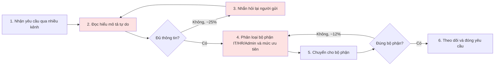
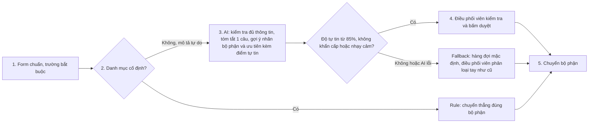

# Báo cáo nhóm — Day 02 Discovery & Problem Framing

> Bản chung của nhóm, viết trên repo do nhóm trưởng fork. Không copy file này sang repo cá nhân. Template chi tiết và prompt mẫu: docs/01-worksheet.md. Bài mẫu: docs/02-deliverable-example.md.

## 1. Thông tin nhóm

- Tên nhóm: SUDO
- Thành viên: xem TEAM.md
- Candidate problem được chọn (1 câu): Khi nhân viên gửi yêu cầu hỗ trợ nội bộ (IT, Hành chính, Nhân sự) qua nhiều kênh với mô tả tự do và thiếu thông tin bối cảnh, nhân sự điều phối (Helpdesk/Admin) phải đọc hiểu, hỏi lại thông tin và phân loại thủ công từng yêu cầu để chuyển đúng bộ phận, gây nghẽn thời gian phản hồi ban đầu và dễ chuyển nhầm đầu mối.
- Quyết định cuối: Go (phạm vi nhỏ — Pilot 2 tuần với Workflow: Form chuẩn hóa + Rule lọc danh mục cố định + AI kiểm tra thiếu thông tin & gợi ý phân loại + Điều phối viên duyệt chuyển)

## 2. Hội tụ nhóm (CP3)

### 2.1. Pitch

(Xem thông tin chi tiết tại file TEAM.md và các bản báo cáo cá nhân)

### 2.2. Cluster

(Xem chi tiết ở bản tổng hợp của nhóm trưởng)

### 2.3. Opportunity Solution Tree rút gọn

(Xem chi tiết ở bản tổng hợp của nhóm trưởng)

### 2.4. Chấm điểm shortlist (1–5)

(Xem chi tiết ở bản tổng hợp của nhóm trưởng)

## 3. Kiểm chứng + research giải pháp đã có (CP4)

### 3.1. Assumption Map

(Xem chi tiết ở Mục 3.1 do Phạm Công Dũng phụ trách)

### 3.2. Kiểm chứng

(Xem chi tiết ở Mục 3.2 do Phạm Công Dũng phụ trách)

### 3.3. Research giải pháp đã có

Phụ trách chính: Nguyễn Huy Hoàng (2A202603366)

| Công cụ / case / pattern | Link | Giải bước nào trong quy trình? | Điểm mạnh | Khoảng trống / rủi ro | Bài học cho nhóm |
|---|---|---|---|---|---|
| Atlassian Rovo / Jira Service Management | https://www.atlassian.com/software/jira/service-management | Giải quyết bước phân loại ticket và đề xuất tài liệu hướng dẫn cho agent. | Tích hợp sâu hệ sinh thái enterprise, AI tự động gắn nhãn và phân nhóm ticket rất mạnh. | Quá cồng kềnh, phức tạp và đắt đỏ đối với các tổ chức quy mô nhỏ (50–200 người). | Không tự xây dựng hệ thống quản lý cồng kềnh từ đầu mà học hỏi mô hình phân loại tự động. |
| Zendesk Intelligent Triage | https://www.zendesk.com/service/ticketing/intelligent-triage/ | Giải quyết bước phân tích ý định (intent) và định tuyến ưu tiên từ yêu cầu thô. | Phân tích cảm xúc và ý định người gửi chuẩn xác, tự động hóa routing luồng nhanh. | Khó tùy chỉnh sâu các quy tắc nghiệp vụ đặc thù nội bộ bên ngoài chăm sóc khách hàng. | Cần thiết kế mô hình AI tập trung vào việc đọc hiểu mô tả tự do và gợi ý nhãn phân loại. |
| Freshservice (Freddy AI) | https://www.freshworks.com/freshservice/ | Giải quyết bước tự động đề xuất danh mục sự cố và gán cho nhóm chuyên môn. | Giao diện trực quan, Freddy AI đề xuất danh mục sự cố dựa trên lịch sử dữ liệu cũ tốt. | Chi phí bản quyền cao, phụ thuộc hoàn toàn vào cơ sở dữ liệu lịch sử sẵn có của nền tảng. | Tận dụng cơ chế rule kết hợp AI để gợi ý danh mục cố định giúp tăng tốc độ xử lý. |
| n8n Workflow Automation (Low-code) | https://n8n.io/ | Giải quyết toàn bộ luồng tích hợp Webhook, gọi LLM API trích xuất JSON và điều phối. | Linh hoạt tuyệt đối, dễ kết nối API tự do (Slack/Form với LLM), chi phí tự host tối ưu. | Đòi hỏi kỹ thuật cấu hình và bảo trì hạ tầng workflow riêng của đội ngũ. | Chọn kiến trúc Workflow (Form + Rule + LLM + HITL) triển khai qua Low-code/API là khả thi nhất cho lab. |

## 4. Quy trình trước/sau (CP5)

### 4.1. Quy trình hiện tại

Sơ đồ (Mermaid):

| Bước | Actor | Input | Output | Thời gian / tần suất | Ghi chú |
|---:|---|---|---|---|---|
| 1 | Nhân viên gửi, điều phối viên nhận | Yêu cầu qua email, chat hoặc trực tiếp | Yêu cầu đã ghi nhận | ~0,3 phút/yêu cầu | ~30 yêu cầu/ngày |
| 2 | Điều phối viên | Mô tả tự do | Hiểu nội dung, nhận ra còn thiếu gì | ~1,0 phút | Bottleneck |
| 3 | Điều phối viên, người gửi | Yêu cầu thiếu thông tin | Thông tin bổ sung | ~0,8 phút (trung bình trên mọi yêu cầu) | Bottleneck; ~25% yêu cầu phải hỏi lại |
| 4 | Điều phối viên | Yêu cầu đã đủ thông tin | Nhãn bộ phận (IT/HR/Admin) và mức ưu tiên | ~0,7 phút | Bottleneck; ~12% bị chuyển nhầm |
| 5 | Điều phối viên | Yêu cầu đã phân loại | Yêu cầu nằm ở đúng hàng đợi bộ phận | ~0,3 phút | |
| 6 | Điều phối viên, bộ phận xử lý | Yêu cầu đang xử lý | Yêu cầu được đóng | ~0,4 phút | |

Tổng: 3,5 phút/yêu cầu, khoảng 105 phút/ngày (30 yêu cầu/ngày). Bước 2–4 chiếm khoảng 2,5 phút. [Cách chia thời gian từng bước là ước tính, cần thay bằng số đo thật nếu có.]

Bottleneck chính: bước 2, 3 và 4. Điều phối viên phải đọc hiểu mô tả tự do thiếu thông tin, nhắn hỏi lại người gửi, rồi phân loại bộ phận và mức ưu tiên bằng tay. Hậu quả: khoảng 25% yêu cầu thiếu thông tin phải hỏi lại và khoảng 12% bị chuyển nhầm bộ phận.

### 4.2. Quy trình tương lai

Mức Workflow (Augment, hỗ trợ con người), dưới 1 phút/yêu cầu.

- **Rule:** form có trường bắt buộc; các danh mục cố định (cấp lại mật khẩu, xin nghỉ phép, đặt phòng họp) được chuyển thẳng, không cần AI.
- **AI (LLM trong Workflow):** với mô tả tự do, kiểm tra đã đủ thông tin chưa, tóm tắt 1 câu, gợi ý nhãn bộ phận (IT/HR/Hành chính) và mức ưu tiên (Khẩn cấp/Thường) kèm điểm tự tin.
- **Con người (HITL):** điều phối viên kiểm tra và bấm duyệt chuyển.
- **Boundary:** AI không tự đóng yêu cầu; không tự chuyển thẳng yêu cầu khẩn cấp, nhạy cảm (HR, Tài chính) hoặc độ tự tin dưới 85% khi chưa có điều phối viên duyệt.
- **Phương án quay về:** nếu AI lỗi hoặc độ tự tin thấp, yêu cầu vào hàng đợi mặc định và điều phối viên phân loại tay như cũ.

### 4.3. Before / after

| Chỉ số | Trước | Sau (kỳ vọng) | Ghi chú |
|---|---|---|---|
| Số bước | 6 | 5 | Gộp đọc hiểu, hỏi lại và phân loại vào form chuẩn, rule và gợi ý của AI |
| Tổng thời gian | 3,5 phút/yêu cầu (~105 phút/ngày) | Dưới 1 phút/yêu cầu | Với 30 yêu cầu/ngày, tiết kiệm khoảng 75 phút/ngày nếu đạt mục tiêu |
| Số bước thủ công | 5 bước do điều phối viên làm tay (bước 2 đến 6) | 1 bước chính (duyệt) với yêu cầu mô tả tự do; 0 bước với danh mục cố định | [Ước tính, cần nhóm xác nhận] |
| Bottleneck chính | Bước 2, 3, 4 | Bước duyệt của điều phối viên | Nút thắt chuyển từ đọc và phân loại sang kiểm tra nhanh |
| Rủi ro mới phát sinh | Không có | AI gợi ý sai và điều phối viên tin quá mức; dữ liệu nhạy cảm gửi cho LLM; người dùng bỏ qua form chuẩn | Giảm bằng HITL, boundary, fallback và ngưỡng dừng |

## 5. Problem Statement v0 (CP5)

(Xem chi tiết ở Mục 5 do Phạm Công Dũng phụ trách)

## 6. Mức can thiệp AI (CP6)

Phụ trách chính: Phạm Việt Hưng

### 6.1. Ma trận độ mơ hồ × độ phức tạp

Bài của nhóm nằm ở ô: độ mơ hồ cao ở đầu vào (mô tả tự do) và độ phức tạp vừa phải (phân loại vào số ít nhãn, thêm mức ưu tiên). [Đối chiếu tên ô với ma trận trong docs/01-worksheet.md.]

Vì sao: yêu cầu cố định (cấp lại mật khẩu, xin nghỉ phép, đặt phòng họp) rule xử lý được; chỉ phần mô tả sự cố tự do hoặc giáp ranh nhiều bộ phận cần AI đọc hiểu. Số nhãn đầu ra ít và có người duyệt nên không cần AI tự lập kế hoạch nhiều bước.

### 6.2. So sánh 4 mức

| Mức | Phương án cho bài của nhóm | Đủ khi nào | Rủi ro | Chọn? |
|---|---|---|---|---|
| No AI (sửa quy trình) | Gom về một kênh, form chuẩn, hướng dẫn cách mô tả | Hầu hết yêu cầu có cấu trúc rõ | Không xử lý được mô tả tự do và yêu cầu giáp ranh bộ phận | Một phần (là nền của Workflow) |
| Rule | Form trường bắt buộc, danh mục cố định, tự chuyển thẳng | Yêu cầu lặp cố định | Cứng nhắc; phân loại sai khi mô tả tự do không khớp danh mục | Một phần (là lớp đầu của Workflow) |
| **Workflow** | Rule cho phần cố định, AI kiểm tra thiếu thông tin và gợi ý nhãn cho mô tả tự do, điều phối viên duyệt | Có phần mơ hồ nhưng quy trình ổn định và cần người kiểm soát | AI gợi ý sai, điều phối viên tin quá mức | **Chọn** |
| Agent | AI tự phân loại, chuyển, hỏi lại và đóng yêu cầu | Tác vụ nhiều bước, ít rủi ro, nhiều ngữ cảnh | Sai ở yêu cầu khẩn cấp hoặc nhạy cảm; khó kiểm soát; vượt nhu cầu quy mô 50–200 người | Không |

Mức chọn: Workflow (Augment).

Vì sao không chọn mức đơn giản hơn: kiểm chứng ở CP4 cho thấy các yêu cầu lặp cố định chỉ cần Form + Rule, nhưng nỗi đau thật nằm ở yêu cầu mô tả sự cố tự do hoặc giáp ranh nhiều bộ phận, nơi Rule và No AI không đọc hiểu được. Nhóm giữ Rule cho phần cố định và chỉ dùng AI đúng chỗ cần. Research ở 3.3 cũng cho thấy đã có công cụ sẵn (Jira Service Management, Zendesk, Freshservice, n8n), nên nhóm chọn cấu hình Workflow thay vì tự xây hệ thống từ đầu.

### 6.3. AI Canvas rút gọn

| Thành phần | Nội dung |
|---|---|
| Prediction — AI dự đoán / tạo ra gì? | Yêu cầu đã đủ thông tin chưa; tóm tắt 1 câu; nhãn bộ phận (IT/HR/Hành chính); mức ưu tiên (Khẩn cấp/Thường); điểm tự tin |
| Judgment — con người cân nhắc, quyết định gì? | Điều phối viên quyết định nhãn có đúng không, yêu cầu có khẩn cấp hoặc nhạy cảm không, có cần hỏi lại người gửi không |
| Action — hành động cuối cùng là gì, ai làm? | Điều phối viên bấm duyệt và chuyển đúng bộ phận, hoặc sửa nhãn, hoặc đẩy về hàng đợi mặc định |
| Outcome — đo kết quả bằng gì? | Thời gian điều phối từ 3,5 xuống dưới 1 phút/yêu cầu; chuyển nhầm từ 12% xuống dưới 3%; hỏi lại thông tin cơ bản từ 25% xuống dưới 8%; điều phối viên đồng ý nhãn AI từ 80% |
| Input — AI cần dữ liệu đầu vào gì mỗi lần chạy? Có sẵn không? | Nội dung mô tả tự do, các trường trong form, danh mục bộ phận và mô tả phạm vi từng bộ phận. Có sẵn khi triển khai form chuẩn; cần xác nhận có log yêu cầu cũ để làm ví dụ mẫu |
| Feedback — lấy phản hồi ở đâu để cải thiện? | Việc điều phối viên sửa nhãn hoặc từ chối gợi ý được ghi lại, dùng để đo tỉ lệ đồng ý và cập nhật ví dụ trong prompt |

### 6.4. Hai câu hỏi của Google PAIR

**Người dùng muốn được hỗ trợ (augment) hay giao hẳn việc (automate)?** Chọn augment. Bằng chứng: kết quả kiểm chứng và research (xem Mục 7, phần thay đổi so với v0) cho thấy không thể giao toàn quyền cho AI vì rủi ro phân loại nhầm bộ phận nhạy cảm; yêu cầu khẩn cấp và nhạy cảm (HR, Tài chính) cần người chịu trách nhiệm, nên thiết kế đặt điều phối viên ở bước duyệt cuối. [Dán thêm trích dẫn phỏng vấn thật ở Mục 3.2 nếu có.]

**AI sai kiểu nào tệ hơn, báo nhầm hay bỏ sót?** Bỏ sót yêu cầu khẩn cấp (gán nhãn "Thường" cho yêu cầu khẩn) tệ hơn báo nhầm (gán "Khẩn cấp" cho yêu cầu thường), vì bỏ sót làm trễ SLA và ảnh hưởng người gửi, còn báo nhầm chỉ làm điều phối viên mất vài giây kiểm tra. Thiết kế xử lý bằng cách:
- yêu cầu khẩn cấp và nhạy cảm luôn qua điều phối viên duyệt, AI không tự chuyển thẳng;
- độ tự tin dưới 85% hoặc AI lỗi thì đẩy về hàng đợi mặc định, không đoán;
- ngưỡng dừng: nếu sau 2 tuần pilot điều phối viên phải sửa hơn 30% nhãn gợi ý, hoặc có yêu cầu khẩn bị phân loại sai làm trễ SLA, nhóm dừng bước AI và quay về Form bắt buộc + Rule.

## 7. Problem Statement v1 + tiêu chí đánh giá (CP6)

Phụ trách chính: Nguyễn Huy Hoàng (2A202603366)

| Trường | Nội dung |
|---|---|
| Actor | Nhân sự điều phối hỗ trợ nội bộ (Helpdesk / Operations / Admin) tại tổ chức quy mô 50–200 người. |
| Quy trình | Tiếp nhận yêu cầu hỗ trợ (IT, Hành chính, Nhân sự) gửi qua kênh chat/form với mô tả tự do và thiếu thông tin bối cảnh. |
| Bottleneck | Điều phối viên phải đọc thủ công, nhắn tin hỏi lại thông tin cơ bản và phân loại nhầm bộ phận (mất 3.5 phút/yêu cầu, 25% thiếu thông tin, 12% nhầm đầu mối). |
| Impact | Gây nghẽn thời gian phản hồi ban đầu, gián đoạn công việc nội bộ và làm quá tải đội ngũ điều phối (~105 phút/ngày). |
| Success Metric (baseline → target, cách đo) | - Thời gian điều phối: từ 3.5 phút xuống < 1 phút/yêu cầu. - Tỉ lệ chuyển nhầm bộ phận: từ 12% xuống < 3%. - Tỉ lệ phải nhắn hỏi lại thông tin cơ bản: từ 25% xuống < 8%. - Tỉ lệ điều phối viên đồng ý với nhãn AI gợi ý: ≥ 80%. |
| Boundary | AI không được tự ý đóng yêu cầu, không tự động chuyển thẳng các yêu cầu khẩn cấp hoặc có độ tự tin thấp khi chưa có điều phối viên duyệt thủ công (HITL). |
| AI intervention point | LLM trong mô-đun Workflow (kiểm tra thông tin thiếu, tóm tắt 1 câu, gợi ý nhãn phân loại bộ phận và mức độ ưu tiên). |
| Mức chọn | Workflow (Augment — Hỗ trợ con người) |
| Rủi ro & người kiểm tra | Rủi ro AI phân loại nhầm hoặc bỏ sót thông tin; điều phối viên Helpdesk là người kiểm tra và bấm duyệt cuối cùng trước khi chuyển bộ phận. |

Thay đổi so với v0 và lý do:

| Trường | v0 (CP5) | v1 (CP6) | Vì sao đổi |
|---|---|---|---|
| Phạm vi giải pháp | Chưa chốt rõ mức can thiệp, hướng tới tự động hóa toàn phần. | Xác định rõ mức Workflow có người duyệt thủ công (HITL). | Kết quả kiểm chứng và research cho thấy không thể giao phó toàn quyền cho AI (rủi ro phân loại nhầm bộ phận nhạy cảm). |
| Success Metrics | Gồm 3 chỉ số cơ bản (thời gian, tỷ lệ nhầm, tỷ lệ hỏi lại). | Bổ sung chỉ số thứ 4: Tỷ lệ điều phối viên đồng ý với nhãn AI gợi ý (≥ 80%). | Cần đo lường trực tiếp độ chính xác và mức độ hữu ích của mô-đun AI trong thực tế vận hành. |
| Boundary | Chỉ nêu chung chung không tự động hóa hoàn toàn. | Quy định rõ: AI không đóng ticket, không tự chuyển ca nhạy cảm/độ tự tin < 85%. | Đảm bảo an toàn vận hành, tránh trôi việc hoặc sai sót do AI hiểu sai ngữ cảnh. |

Tiêu chí đánh giá đầu ra của AI (Eval):

| # | Tiêu chí | Đạt khi | Không đạt khi |
|---|---|---|---|
| 1 | Độ chính xác nhãn gợi ý (Category Accuracy) | AI gợi ý đúng bộ phận xử lý đạt ≥ 80% so với thực tế duyệt. | AI gợi ý sai bộ phận xử lý vượt quá 20% tổng số ca test. |
| 2 | Khả năng phát hiện thông tin thiếu (Missing Info Detection) | Nhận diện chính xác 100% các yêu cầu thiếu bối cảnh cốt lõi để kích hoạt câu hỏi bổ sung. | Bỏ sót các trường hợp thiếu thông tin bắt buộc, khiến điều phối viên vẫn phải hỏi lại thủ công. |
| 3 | Độ trễ xử lý (Latency) | Thời gian phản hồi phân tích của AI dưới 3 giây kể từ khi nhận request. | Thời gian phản hồi kéo dài trên 5 giây, gây gián đoạn luồng thao tác. |
| 4 | Tuân thủ Boundary | Các yêu cầu có độ tự tin thấp tuyệt đối không tự động chuyển mà phải qua điều phối viên duyệt thủ công (tuân thủ 100%). | AI tự động chuyển hoặc tự xử lý các ca có độ tự tin thấp mà không cần con người duyệt. |

## 8. Quyết định (CP6)

## 9. Hạn chế và hướng tiếp theo

## 10. Tài liệu tham khảo

Bổ sung bởi: Nguyễn Huy Hoàng (2A202603366)

- Tài liệu hướng dẫn Day 02: Discovery & Problem Framing (K5 Level 3).
- Atlassian Jira Service Management & Zendesk Intelligent Triage Product Documentation.
- Freshservice Freddy AI Capabilities Overview.
- n8n Low-code Workflow Automation Documentation.
- Ghi chú khảo sát và kiểm chứng thực tế từ đội ngũ Vận hành nội bộ.
- Google PAIR, *People + AI Guidebook* (Mục 6.4).
- Agrawal, A., Gans, J., Goldfarb, A. *Prediction Machines* (nguồn của AI Canvas, Mục 6.3).